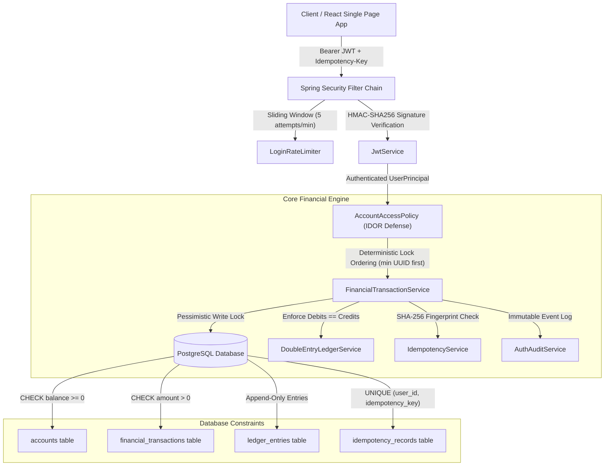

# Arthivex — Secure Financial Transaction & Double-Entry Ledger Management System

> **Rebranding Notice:** This project was originally conceived and developed under the working name **FinGuard** and has been officially rebranded to **Arthivex** (*Arthivex — Secure Financial Transaction & Ledger Management System*). For technical stability and backward compatibility with deployed infrastructure, the underlying Java package namespace (`com.finguard`), database schema (`finguard`), and database role (`finguard_app`) are intentionally preserved.

Arthivex is an enterprise financial transaction management platform engineered with a strict zero-trust security architecture. Built from scratch for the 7-day individual hiring challenge, Arthivex ensures all money movement is authoritative, atomic, traceable, and mathematically balanced via an immutable double-entry ledger.

---

## 1. Project Overview

In traditional applications, financial balances and state are vulnerable to client-side manipulation, race conditions, negative balance exploits, and duplicate transaction submission. Arthivex solves these challenges by treating the backend as the sole authoritative boundary:
- **Zero Client Trust**: All authorization, balances, account ownership, and idempotency are strictly computed and verified on the server.
- **Double-Entry Bookkeeping**: Every financial event (deposit, withdrawal, transfer) atomically records balanced debit and credit ledger entries. Total Debits strictly equal Total Credits.
- **Race Condition & Deadlock Immunity**: Deterministic pessimistic database locking eliminates negative balance overdrafts and cyclic deadlocks during concurrent opposite-direction transfers.
- **Strict Idempotency**: Network retries and duplicate submissions are safely deduplicated using RFC 4122 idempotency keys backed by SHA-256 canonical payload fingerprinting.

---

## 2. Main Features

- **Stateless Bearer JWT Authentication**: HMAC-SHA256 tokens with externalized secrets (>= 256 bits), issuer verification, expiration enforcement, and rejection of `alg: none`.
- **Role-Based Access Control (RBAC)**: Fine-grained permissions supporting `ACCOUNT_HOLDER`, `ADMINISTRATOR`, and `AUDITOR` roles with default-deny Spring Security filter chains.
- **Server-Side Account Ownership (IDOR/BOLA Defense)**: Centralized `AccountAccessPolicy` ensures users can only view and mutate their own accounts and transaction records.
- **Deposit & Disbursement Engine**: Supports institutional deposits, external wire disbursements, and internal inter-vault transfers with balance consistency guarantees.
- **Atomic Double-Entry Ledger**: Immutable append-only `ledger_entries` table. Balances are re-verified against cumulative debit/credit sums.
- **Deterministic Pessimistic Concurrency**: Eliminates race conditions and deadlocks by sorting account UUIDs prior to acquiring pessimistic write locks.
- **Brute-Force & Credential Stuffing Protection**: Sliding-window rate limiter blocking IP/identifier after 5 consecutive failed login attempts.
- **Dynamic Real-Time Dashboard**: Interactive React dashboard computing consolidated balances, 30-day cash flow inflows/outflows, dynamic 6-bucket liquidity volume analysis, and multi-account portfolios without fabricated demonstration data.

---

## 3. Technology Stack

### Backend
- **Framework**: Java 17+ / Java 24, Spring Boot 3.4.3
- **Security**: Spring Security 6 (Stateless JWT, BCrypt cost 12, CORS allowlist, Security Headers)
- **Persistence**: Spring Data JPA, Hibernate ORM
- **Database**: PostgreSQL 15+ (production / local), H2 Database (in-memory test profile)
- **Database Migrations**: Flyway Database Migration (V1 Initial Schema, V2 Financial Ledger, V3 Idempotency Records)
- **Token Handling**: JJWT (Java JWT) 0.12.6 (HMAC-SHA256)
- **Testing**: JUnit 5, MockMvc, AssertJ

### Frontend
- **Framework**: React 18.3, Vite 6.0
- **Routing**: React Router DOM v6.28
- **Styling**: Tailwind CSS 3.4 (Custom Stitch Enterprise Dark Theme)
- **Icons & Typography**: Google Material Symbols Outlined, Inter & JetBrains Mono fonts

---

## 4. System Architecture



---

## 5. Directory Structure

```text
FinGuard/
├── backend/
│   ├── src/main/java/com/finguard/
│   │   ├── config/             # Spring Security, CORS, Dotenv, Jackson configuration
│   │   ├── controller/         # REST Controllers (Auth, Accounts, Transactions, Transfers)
│   │   ├── dto/                # Request & Response Data Transfer Objects
│   │   ├── entity/             # JPA Entities (User, Account, FinancialTransaction, LedgerEntry, AuditEvent, IdempotencyRecord)
│   │   ├── exception/          # GlobalExceptionHandler and domain exceptions
│   │   ├── repository/         # Spring Data JPA Repositories (Pessimistic Locks)
│   │   ├── security/           # JwtService, JwtAuthenticationFilter, UserPrincipal, RateLimiter
│   │   └── service/            # FinancialTransactionService, DoubleEntryLedgerService, AccountService, IdempotencyService
│   ├── src/main/resources/
│   │   ├── db/migration/       # Flyway SQL Migrations (V1, V2, V3)
│   │   └── application.yml     # Spring Boot application configuration
│   ├── src/test/               # 12 Integration & Unit Test Suites (106 verified tests)
│   ├── .env.example            # Environment configuration template
│   ├── mvnw.cmd / mvnw         # Maven Wrapper scripts
│   └── pom.xml                 # Maven build POM
├── frontend/
│   ├── src/
│   │   ├── components/         # TopHeader, Sidebar, Navigation, Modals
│   │   ├── context/            # AuthContext (JWT session state)
│   │   ├── pages/              # DashboardPage, AccountsPage, DepositPage, WithdrawPage, TransferPage, etc.
│   │   └── services/           # apiClient, authService, accountService, transactionService
│   ├── package.json            # Vite & React dependencies
│   ├── tailwind.config.js      # Stitch design system tokens
│   └── vite.config.js          # Vite build configuration
├── PROJECT_CONTEXT.md          # Business and functional requirements specification
├── BACKEND.md                  # Backend architecture specification
├── FRONTEND.md                 # Frontend architecture specification
├── THREATS.md                  # Threat model & automated verification evidence
├── PROMPTS.md                  # Development prompt history
└── README.md                   # This project guide
```

---

## 6. Prerequisites

- **Java Development Kit**: JDK 17 or higher (tested with Oracle JDK 24 and Eclipse Temurin 21).
- **Node.js**: v18.0.0 or higher with npm 9+.
- **Database**: PostgreSQL 15+ (local or containerized).
- **Build Tool**: Maven 3.9+ (or included Maven wrapper `mvnw.cmd` / `mvnw`).

---

## 7. PostgreSQL Database Setup

1. Start your local PostgreSQL server on default port `5432`.
2. Open `psql` or your preferred database GUI (pgAdmin / DBeaver):
   ```sql
   CREATE DATABASE finguard;
   CREATE USER finguard_app WITH ENCRYPTED PASSWORD 'finguard_secure_password';
   GRANT ALL PRIVILEGES ON DATABASE finguard TO finguard_app;
   \c finguard
   GRANT ALL ON SCHEMA public TO finguard_app;
   ```
3. Flyway will automatically execute database migrations (`V1__initial_schema.sql`, `V2__financial_transactions_and_ledger.sql`, `V3__idempotency_records.sql`) upon backend startup.

---

## 8. Environment Configuration

1. In the `backend/` directory, copy `.env.example` to `.env`:
   ```bash
   cp backend/.env.example backend/.env
   ```
2. Configure `.env` with your local database credentials:
   ```properties
   PORT=8080
   DB_URL=jdbc:postgresql://localhost:5432/finguard
   DB_USERNAME=finguard_app
   DB_PASSWORD=finguard_secure_password
   JWT_SECRET=super_secret_high_entropy_jwt_key_at_least_32_characters_long!
   JWT_EXPIRATION_MINUTES=30
   JWT_ISSUER=finguard-auth-service
   CORS_ALLOWED_ORIGINS=http://localhost:5173
   ```
> **Security Notice**: `.env` is strictly excluded in `.gitignore`. Never commit `.env` or production credentials to source control.

---

## 9. Backend Startup Instructions

From the repository root:
```bash
cd backend
.\mvnw.cmd spring-boot:run
```
*(On Linux/macOS: `./mvnw spring-boot:run`)*

The Spring Boot server initializes on `http://localhost:8080`.
Verify startup with the public health check endpoint:
```bash
curl http://localhost:8080/api/v1/health
# Response: {"status":"UP","service":"finguard-backend","timestamp":"..."}
```

---

## 10. Frontend Startup Instructions

From the repository root:
```bash
cd frontend
npm install
npm run dev
```
The React development server starts on `http://localhost:5173`. Open your browser to access the Arthivex web application.

To verify a production build:
```bash
npm run build --prefix frontend
```

---

## 11. Authoritative API Endpoint Overview

All endpoints except `/auth` and `/health` require `Authorization: Bearer <JWT>` header. Mutating financial endpoints require `Idempotency-Key: <UUID>`.

| Method | Endpoint | Description | Auth Required | Idempotency Key |
|---|---|---|---|---|
| `POST` | `/api/v1/auth/register` | Register a new user (`ROLE_USER`) | No | No |
| `POST` | `/api/v1/auth/login` | Authenticate and obtain JWT access token | No | No |
| `GET` | `/api/v1/auth/me` | Retrieve currently authenticated user principal | Yes | No |
| `GET` | `/api/v1/accounts` | List accounts owned by authenticated user | Yes | No |
| `POST` | `/api/v1/accounts` | Create new account (starts at strictly $0.00) | Yes | No |
| `GET` | `/api/v1/accounts/{id}` | Retrieve specific account details (IDOR checked) | Yes | No |
| `POST` | `/api/v1/accounts/{id}/deposits` | Deposit funds (credits account, debits clearing) | Yes | Optional |
| `POST` | `/api/v1/accounts/{id}/withdrawals` | Withdraw funds (debits account, credits clearing) | Yes | Optional |
| `POST` | `/api/v1/transfers` | Atomic account-to-account transfer | Yes | **Mandatory** |
| `GET` | `/api/v1/transactions` | Query recent transactions across user accounts | Yes | No |
| `GET` | `/api/v1/transactions/{id}` | Query transaction details and balanced ledger entries | Yes | No |
| `GET` | `/api/v1/health` | Service health status | No | No |

---

## 12. Testing Commands & Verified Results

Arthivex contains an exhaustive automated test suite validating security boundaries, financial invariants, and adversarial attack scenarios:

### Execution Command
```powershell
cd backend
.\mvnw.cmd clean test
```

### Verified Test Suite Breakdown (128 / 128 Tests Passing)
All 128 automated unit and integration tests execute with **100% PASS** rate (0 Failures, 0 Errors, 0 Skipped), verifying:
- Stateless Bearer JWT authentication, expiration enforcement, and secret entropy.
- Role-based authorization (`ACCOUNT_HOLDER`, `ADMINISTRATOR`, `AUDITOR`).
- Pessimistic write locking and deterministic deadlock-free multi-account transfer ordering.
- Immutable double-entry ledger debit/credit mathematical parity.
- RFC 4122 idempotency deduplication with SHA-256 canonical fingerprinting.
- Server-side IDOR / BOLA authorization policies.
- In-memory and Redis-backed sliding-window rate limiting.
- System audit logging, onboarding tracking, and administrative governance.

---

## 13. Security Features & Residual Limitations

### Implemented Controls
1. **Double-Entry Invariant**: Enforces `sum(debits) == sum(credits)` on every transaction.
2. **Pessimistic Locking**: `findByIdWithPessimisticLock` on account rows prevents concurrent double-spending.
3. **Deterministic Deadlock Prevention**: Lock acquisition order is sorted by UUID (`firstId = min(src, dst)`).
4. **Idempotency Fingerprinting**: Same key with different payload triggers HTTP 409 Conflict.
5. **IDOR / BOLA Prevention**: Object-level access policy enforces authenticated ownership check.
6. **Rate Limiting**: Failed logins restricted to 5 attempts per minute per identifier.
7. **Database Constraints**: `CHECK (balance >= 0.00 OR account_type = 'CLEARING')`.

### Operational Limitations
- **Node-Local Rate Limiting**: The built-in rate limiter operates in-memory (`ConcurrentHashMap`). In a clustered multi-instance deployment, rate limiting should be delegated to Redis or an API gateway.
- **Stateless Token Window**: JWT access tokens have a fixed 30-minute lifespan without refresh tokens.
- **Single Database Node**: Local setup runs on a standalone PostgreSQL database; high-availability requires active-passive clustering.

---

## 14. Local Development Instructions

1. Use `.env` in `backend/` for local credentials.
2. The backend test profile (`application-test.yml`) automatically uses an in-memory H2 database in PostgreSQL compatibility mode, allowing tests to run in isolation without affecting your local PostgreSQL database.
3. The frontend proxies or directly accesses `http://localhost:8080/api/v1` via Vite's environment config (`VITE_API_BASE_URL`).

---

## 15. Deployment Considerations

- **Containerization**: Package the Spring Boot backend into an OCI container using Eclipse Temurin 21 base image; build the React frontend into static assets served via Nginx.
- **Secrets Management**: In cloud production (AWS / GCP / Kubernetes), inject `DB_PASSWORD` and `JWT_SECRET` via environment secrets (AWS Secrets Manager, HashiCorp Vault, or Kubernetes Secrets).
- **Database Scaling**: Use managed PostgreSQL (AWS RDS / GCP Cloud SQL) with automated WAL archiving and read-replicas for reporting.

---

## 16. Five-Minute Hiring Challenge Demonstration Guide

| Timestamp | Phase | What to Demonstrate | Key Talking Point |
|---|---|---|---|
| **0:00 - 1:00** | **Architecture & Test Suite** | Run `.\mvnw.cmd test` in terminal. Show **128 passing tests** across all suites, highlighting adversarial security tests and atomic transfer concurrency tests. | *"Arthivex treats the backend as the sole authoritative boundary. 128 automated tests verify zero-trust security and financial correctness."* |
| **1:00 - 2:00** | **Fresh User Zero-State** | Register a new user at `http://localhost:5173/register`. Log in and observe the clean Dashboard displaying **₹0.00 balance**, 0 accounts, and clean empty states. | *"Arthivex never fabricates mock balances for new users. The dashboard is 100% data-driven from the authoritative ledger."* |
| **2:00 - 3:00** | **Vault Creation & Deposit** | Create an internal financial account. Deposit `₹25,000.00`. Observe the real-time balance update, 30-day inflow metric, and dynamic liquidity chart bar. | *"Account numbers are generated securely server-side. Deposits credit the user vault and debit the clearing account in a single atomic transaction."* |
| **3:00 - 4:00** | **Atomic Transfer & Ledger** | Create a second account. Transfer `₹10,000.00` with an idempotency key. Verify total balance remains ₹25,000.00. Inspect the Audit Record modal. | *"Transfers acquire pessimistic locks in deterministic order to prevent race conditions and deadlocks. Total debits strictly equal total credits."* |
| **4:00 - 5:00** | **Attack Rejection Showcase** | Open Developer Tools Network tab. Attempt an overdraft withdrawal of `₹50,000.00`. Show immediate backend rejection: **HTTP 422 Unprocessable Entity (`INSUFFICIENT_FUNDS`)**. | *"The backend prevents negative balances at application lock and database check constraint levels. Every unauthorized operation is audited."* |

---

## 17. License & Credits

Developed as part of the individual 7-day hiring challenge.  
Designed with the Arthivex Dark & Light Enterprise theme (inspired by Stitch UI designs).  
All rights reserved.

