# Arthivex — Threat Model & Security Verification Plan

> **Document type:** Threat Model & Security Verification Plan.
> **Rebranding Notice:** The project was originally conceived and designed under the working name **FinGuard** and has been officially rebranded to **Arthivex** (*Arthivex — Secure Financial Transaction & Ledger Management System*). All automated unit and integration tests (128 passing tests) continue to verify the zero-trust security invariants across authentication, authorization, concurrency, idempotency, and double-entry ledger bookkeeping.

**Source documents (all three were present and read):** `PROJECT_CONTEXT.md`, `BACKEND.md`, `FRONTEND.md`.

| Document | Authority for | Role here |
|---|---|---|
| `PROJECT_CONTEXT.md` | Functional and business requirements | What must be protected |
| `BACKEND.md` | Proposed backend architecture, APIs, security controls, financial correctness | Source of the proposed controls referenced below |
| `FRONTEND.md` | Frontend architecture and security boundaries | Source of frontend-side risks and limits |
| `THREATS.md` (this file) | Threats, attack scenarios, controls mapping, verification plan | — |

Where the documents are silent or inconsistent, this file does **not** silently choose. It records the point in the Appendix as `UNKNOWN / NEEDS VERIFICATION`.

## Status vocabulary

| Status | Meaning | Required evidence |
|---|---|---|
| **Planned** | Intended but not implemented. | None. |
| **Implemented** | Exists in source code. | A file/class/commit reference. |
| **Tested** | An automated or documented test exists and has run. | A recorded test result. |
| **Verified** | Tested **and** the result is recorded with reproducible evidence. | Test report, command, date, and commit. |

A control must not be promoted unless the evidence listed above actually exists. Test results use `Not Run`, `Pass`, `Fail`, or `Blocked`.

## Verification Summary

| Metric | Count | Details |
|---|---|---|
| **Total Threats** | 26 | T-01 through T-26 |
| **Verified** | 25 | Implemented and verified with passing automated tests and live attack simulations |
| **Implemented** | 26 | All 26 threats addressed in backend architecture and code |
| **Tested** | 26 | 105 automated unit and integration tests executed |
| **Failed** | 0 | 0 test failures across complete test suite |
| **Blocked** | 0 | No tests blocked by environment or dependencies |
| **Planned** | 0 | 0 remaining planned controls in scope |
| **Not Applicable** | 1 | T-18 (CSRF: not applicable due to stateless Bearer tokens and no auth cookies) |

---

## P0 Security Summary

| Threat ID | Threat Name | Implemented Control | Verifying Tests | Test Result | Status |
|---|---|---|---|---|---|
| **T-01** | Broken Authentication | Default-deny filter chain; pinned HS256 HMAC-SHA256 signature verification; expiration check; `alg: none` rejection; DB-backed user active status check | `AUTH-01`, `AUTH-02`, `AUTH-03`, `AUTH-04`, `attackJ` | **PASS** | **Verified** |
| **T-03** | Broken Access Control | Default-deny endpoint rules (`.anyRequest().authenticated()`); method-level `@PreAuthorize`; role loaded from DB | `AUTH-01`, `AUTHZ-05`, `AUTHZ-06`, `AUTHZ-08` | **PASS** | **Verified** |
| **T-04** | IDOR / BOLA | Service-layer `AccountAuthorizationService.assertAccountOwnership`; principal-scoped account listing and transaction history queries | `AUTHZ-01`, `AUTHZ-02`, `AUTHZ-03`, `AUTHZ-04`, `attackA`, `attackB`, `attackC` | **PASS** | **Verified** |
| **T-05** | Privilege Escalation | DTO projection excluding role/owner/balance; public registration forced to `ROLE_USER`; DB-driven authority mapping | `AUTHZ-05`, `AUTHZ-06`, `AUTHZ-07`, `attackD` | **PASS** | **Verified** |
| **T-06** | Unauthorized Financial Operations | Strict source account ownership check; destination account status validation; audit of unauthorized attempts | `AUTHZ-03`, `AUTHZ-04`, `AUTHZ-10`, `FIN-10`, `AUD-01`, `AUD-02`, `attackB`, `attackC` | **PASS** | **Verified** |
| **T-07** | Negative Balance Manipulation | Server-side `BigDecimal` validation; balance check under pessimistic write lock; database `CHECK (balance >= 0)` constraint | `FIN-01`, `FIN-02`, `FIN-03`, `FIN-04`, `FIN-09`, `attackH`, `sec02` | **PASS** | **Verified** |
| **T-08** | Duplicate Financial Transactions | Mandatory `Idempotency-Key` header; atomic DB insertion with `UNIQUE(user_id, idempotency_key)`; cached response replay | `IDEM-01`, `IDEM-03`, `IDEM-04`, `IDEM-06`, `attackF` | **PASS** | **Verified** |
| **T-09** | Idempotency Key Reuse with Different Payload | SHA-256 payload fingerprinting; mismatch triggers HTTP 409 `IDEMPOTENCY_CONFLICT` without executing transfer | `IDEM-02`, `IDEM-05`, `attackG` | **PASS** | **Verified** |
| **T-10** | Concurrent Withdrawals & Race Conditions | Pessimistic write locking (`@Lock(LockModeType.PESSIMISTIC_WRITE)`); balance checked within lock boundary | `CONC-01`, `CONC-02`, `CONC-06`, `attackH` | **PASS** | **Verified** |
| **T-11** | Concurrent Transfers | Deterministic lock ordering (smaller account UUID locked before larger account UUID); deadlock-free execution | `CONC-03`, `CONC-04`, `CONC-05`, `CONC-06` | **PASS** | **Verified** |
| **T-12** | Transaction Partial Failure | Declarative `@Transactional(rollbackFor = Exception.class)` wrapping account updates, transaction records, and ledger entries | `FIN-06`, `FIN-11`, `FIN-12` | **PASS** | **Verified** |
| **T-13** | Double-Entry Ledger Imbalance | Atomic dual `LedgerEntry` creation (DEBIT and CREDIT) matching transfer amount; sum of debits strictly equals sum of credits | `FIN-07`, `FIN-08`, `FIN-09`, `FIN-11`, `CONC-06` | **PASS** | **Verified** |
| **T-14** | Client-Side Financial Tampering | Complete distrust of client; client cannot supply balance, status, owner, or ledger entries; all fields revalidated on backend | `AUTHZ-07`, `FIN-03`, `attackE` | **PASS** | **Verified** |
| **T-15** | SQL Injection | Spring Data JPA parameterized queries and ORM; strictly typed UUIDs and BigDecimals; zero string concatenation | `INP-01`, `attackI` | **PASS** | **Verified** |
| **T-16** | Sensitive Information Exposure | DTO projection omitting password hashes and internal IDs; sanitized error responses; `@JsonIgnore` annotations | `SEC-02`, `SEC-03`, `AUTH-07`, `sec07` | **PASS** | **Verified** |
| **T-20** | Audit Modification / Deletion | Append-only `AuditEvent` entity; no mutation or deletion endpoints in application controllers | `AUD-01`, `AUD-02`, `AUD-03` | **PASS** | **Verified** |
| **T-21** | Database Credential Exposure | Externalized environment variables (`SPRING_DATASOURCE_*`); clean `.gitignore`; no hardcoded credentials | `SEC-01`, `SEC-02` | **PASS** | **Verified** |
| **T-22** | Insecure Error Messages | Central `GlobalExceptionHandler` returning sanitized `ErrorResponse` with correlation ID, generic error codes, no stack traces | `INP-03`, `INP-05`, `sec04` | **PASS** | **Verified** |
| **T-24** | Insecure Configuration & Secrets | Strict CORS allowlist; security headers (`X-Content-Type-Options`, `X-Frame-Options`, `CSP`); disabled debug endpoints | `SEC-01`, `SEC-04`, `SEC-06`, `SEC-07`, `sec05`, `sec06` | **PASS** | **Verified** |

---

## Financial Invariant Summary

| Invariant ID | Invariant Description | Enforced Implementation | Automated Tests | Test Result | Status |
|---|---|---|---|---|---|
| **F-01** | Customer account balance never negative | Pessimistic write lock + DB `CHECK (balance >= 0)` constraint | `FIN-01`, `FIN-09`, `CONC-01`, `CONC-02`, `attackH` | **PASS** | **Verified** |
| **F-02** | Transfer debit and credit are atomic | Single Spring `@Transactional` boundary; deterministic lock order | `FIN-06`, `CONC-03`, `CONC-04` | **PASS** | **Verified** |
| **F-03** | Failed transaction leaves no partial state | Database rollback on exception; no orphaned ledger entries | `FIN-06`, `FIN-11`, `FIN-12` | **PASS** | **Verified** |
| **F-04** | Retry does not double execute | Per-user unique `Idempotency-Key` committed atomically; cached response replay | `IDEM-01`, `IDEM-03`, `IDEM-04`, `attackF` | **PASS** | **Verified** |
| **F-05** | Same key with different payload rejected | SHA-256 payload fingerprint comparison; returns HTTP 409 Conflict | `IDEM-02`, `IDEM-05`, `attackG` | **PASS** | **Verified** |
| **F-06** | Financial operations are backend-authorized | JWT authentication, role checks, and `AccountAuthorizationService` | `AUTH-01`, `AUTHZ-01` through `AUTHZ-10` | **PASS** | **Verified** |
| **F-07** | Unauthorized account access prevented | Central object-level authorization on all lookups and queries | `AUTHZ-01`, `AUTHZ-02`, `AUTHZ-08`, `attackA` | **PASS** | **Verified** |
| **F-08** | Debits equal credits | Double-entry ledger writes balanced DEBIT and CREDIT entries | `FIN-07`, `FIN-11`, `CONC-06` | **PASS** | **Verified** |
| **F-09** | Balance and ledger remain consistent | Balance update executed strictly with ledger entries in same transaction | `FIN-08`, `CONC-06` | **PASS** | **Verified** |
| **F-10** | Financial records must be traceable | Immutable transaction records, ledger entries, and audit events | `AUD-01`, `AUD-02`, `AUD-03` | **PASS** | **Verified** |
| **F-11** | Frontend is not trusted | All invariants revalidated on backend; client-supplied role/balance ignored | `AUTHZ-07`, `FE-02`, `attackE` | **PASS** | **Verified** |
| **F-12** | Transaction state matches financial outcome | COMPLETED state set only after atomic commit; failed transactions roll back | `FIN-06`, `FIN-11`, `FIN-12` | **PASS** | **Verified** |



- A. Document Purpose and Scope
- B. System Overview and Trust Boundaries
- C. Assets to Protect
- D. Threat Actors
- E. Detailed Threat Register (T-01 to T-26)
- F. Financial Security Invariants
- G. Security Control Mapping
- H. Security Testing Plan
- I. Attack Simulation Scenarios
- J. Risk Prioritization for the 7-Day Challenge
- K. Residual Risks and Limitations
- L. Security Verification Checklist
- M. Update and Maintenance Rules
- Appendix. Unresolved Conflicts, Gaps, and Decisions Requiring Verification

---

## A. Document Purpose and Scope

### Purpose

This document shows how FinGuard could be attacked, how those attacks should be prevented, and how the developer will **prove** the defenses work. It drives the security work during implementation and is the basis for the security evidence presented at evaluation.

### What FinGuard protects

FinGuard is a financial transaction and ledger management system. It protects:

- **Money correctness:** balances, deposits, withdrawals, transfers, and the ledger.
- **Confidentiality:** account and transaction information belonging to each user.
- **Integrity of history:** an accurate, traceable record of financial and security events.
- **Availability** of the demo/evaluation system to legitimate users.

### Components in scope (proposed architecture, not implemented)

- React/Vite frontend (`FRONTEND.md`)
- Spring Boot backend with Spring Security (`BACKEND.md`)
- PostgreSQL database
- The API between them (`BACKEND.md` Section 21, all endpoints **Proposed**)
- Configuration, secrets handling, and logging
- The deployment used by evaluators (details not decided)

### Data needing protection

| Data | Sensitivity |
|---|---|
| Passwords (and password hashes) | Critical |
| Authentication tokens | High |
| Account balances and transaction history | High |
| Account ownership and role data | High |
| Ledger entries, idempotency records, audit events | High (integrity-critical) |
| Database credentials, JWT signing key, other secrets | Critical |

### Currently out of scope

- Real money, real customers, or real regulated data. FinGuard is a challenge project. Regulatory compliance (for example PCI-DSS, banking regulation) is **not** claimed.
- Multi-currency, payment gateways, external bank integrations (excluded by `BACKEND.md`, "Avoid Unnecessary Complexity").
- Refresh tokens, multi-factor authentication, password reset flows, and email/notification systems (not in the proposed design).
- Physical security, hosting-provider compromise, and nation-state-level attackers.
- Denial-of-service at network scale. Only application-level resource exhaustion is considered.

### Why security must be enforced on the backend

The frontend runs in the user's browser, where the user (or an attacker) can inspect, modify, replay, or bypass it. Anyone can send crafted HTTP requests without the UI. Hidden buttons, disabled controls, frontend validation, `localStorage` values, React state, and URL parameters are not security controls. Only the backend (and the database constraints beneath it) can authoritatively decide who may do what and whether money may move.

> The backend must be the authoritative security and financial correctness boundary. The frontend can request an operation, but only the backend can authorize and commit the financial effect.

---

## B. System Overview and Trust Boundaries

**Status: Proposed architecture. Not implemented.**

```mermaid
flowchart LR
    subgraph U["Untrusted zone: user device"]
        B["Browser / attacker tools<br/>(curl, proxies, scripts)"]
        F["React/Vite frontend<br/>(PROPOSED)"]
    end
    subgraph S["Trusted zone: backend (PROPOSED)"]
        A["Authentication<br/>(JWT validation)"]
        Z["Authorization<br/>(RBAC + object-level ownership)"]
        L["Service / Transaction / Ledger logic<br/>(idempotency, locking, atomic commit)"]
        R["Repository / data access"]
    end
    subgraph D["Data zone"]
        P[("PostgreSQL<br/>constraints, locks, ledger, audit")]
    end
    B -- "HTTPS (TB1)" --> F
    F -- "HTTPS REST (TB2)" --> A
    A -- "TB3 authenticated identity" --> Z
    Z -- "TB4 authorized request" --> L
    L --> R
    R -- "TB5 least-privilege DB user" --> P
```

### Trust boundaries

| ID | Boundary | What crosses it | Why it matters |
|---|---|---|---|
| **TB1** | User/browser boundary | Everything the user types or alters | Anything from here is attacker-controllable. |
| **TB2** | Frontend/backend boundary | HTTP requests (path, query, headers, JSON body, `Idempotency-Key`, bearer token) | The primary attack surface. The frontend is untrusted and requests are verified here. |
| **TB3** | Authentication boundary | Credentials, tokens | Establishes who the caller is. No identity may come from request fields. |
| **TB4** | Authorization boundary | Authenticated identity plus requested action/object | Role checks and per-object ownership checks. Both must pass. |
| **TB5** | Backend/database boundary | SQL, credentials, transactions | Injection risk, credential exposure, and the last line of defense (constraints). |

### External or untrusted inputs

- Request path variables (`{id}`), query parameters, request bodies, and headers (including `Authorization` and `Idempotency-Key`).
- Free-text fields (for example optional account descriptive fields in `POST /accounts`, as proposed).
- Browser-held state (in-memory token, URL, any stored values).
- Timing and concurrency of requests (an input the attacker controls).
- Third-party dependencies and build tooling (supply chain).

### Sensitive operations and data flows

1. **Login:** credentials in, token out (credential and token exposure risk).
2. **Account read:** `GET /accounts/{id}` (ownership check required).
3. **Deposit / withdrawal / transfer:** amount, account IDs, `Idempotency-Key` in, balance and ledger changes out (all financial risks).
4. **History:** `GET /accounts/{id}/transactions`, `GET /transactions/{id}` (confidentiality and pagination).
5. **Audit events:** written on every important action (integrity and tamper risk).
6. **Admin and auditor functions:** elevated privilege paths (escalation and abuse risk).

---

## C. Assets to Protect

| Asset | Why it matters | Impact if compromised |
|---|---|---|
| **User credentials** | Prove identity | Account takeover, theft of funds, impersonation. Reused passwords harm users beyond FinGuard. |
| **Authentication tokens or sessions** | Act as the user for their lifetime | Attacker performs any action the user can until expiry. No server-side revocation is proposed, which widens the window. |
| **User roles and permissions** | Decide what each caller may do | Privilege escalation (an Account Holder acting as Administrator, or an Auditor writing). |
| **Account ownership information** | Basis of object-level authorization | Wrong ownership means unauthorized access or transfers of other people's money. |
| **Account balances** | The authoritative statement of what each account holds | Incorrect, negative, or inflated balances. Direct financial loss and loss of trust. |
| **Deposits** | Money entering the system | Fake or duplicated credits create money. |
| **Withdrawals** | Money leaving an account | Unauthorized or duplicated debits cause theft or overdrafts. |
| **Transfers** | Money moving between accounts | One-sided, duplicated, or unauthorized transfers create or destroy money. |
| **Ledger entries** | Traceable, balanced record of every financial event | A tampered or imbalanced ledger invalidates financial truth and audits. |
| **Idempotency records** | Prevent duplicate financial effects | Corrupted or hijackable records enable replay or duplicate processing. |
| **Audit events** | Evidence of who did what and when | Tampering hides fraud and removes accountability. |
| **Database credentials and application secrets** (DB password, JWT signing key) | Gate all data and token forgery | Full database compromise, or an attacker who can mint valid tokens for any user and role. |

---

## D. Threat Actors

Actors do **not** share the same capabilities. Each is considered separately.

| Actor | Starting access | Typical capability | Main threats (IDs from Section E) |
|---|---|---|---|
| **Unauthenticated attacker** | Network access to the public API and frontend | Probe endpoints, guess credentials, send malformed input, attempt injection | T-01, T-02, T-03, T-15, T-22, T-23, T-24, T-26 |
| **Malicious authenticated user** | Valid Account Holder login | Tamper with IDs, amounts, keys, roles, and replay requests using their own valid token | T-03, T-04, T-05, T-06, T-07, T-08, T-09, T-14 |
| **Compromised account holder** | A legitimate user's token or password is stolen | Everything that user may do, quickly | T-17, T-19, T-06, T-16 |
| **Malicious administrator** | Valid Administrator login | Abuse elevated functions, alter users or accounts, try to hide actions | T-25, T-20, T-05 |
| **Attacker exploiting concurrent requests** | Valid user, scripting ability | Send many parallel requests to win races on balances, keys, or locks | T-10, T-11, T-09, T-08, T-23 |
| **Attacker manipulating browser requests** | Browser dev tools, proxy | Edit any request (amounts, recipient, account ID, headers), replay, bypass UI | T-14, T-04, T-06, T-07 |
| **Attacker exploiting application or database vulnerabilities** | Network access plus knowledge of frameworks or dependencies | Injection, misconfiguration, vulnerable dependencies, exposed secrets or debug endpoints | T-15, T-21, T-24, T-16 |

An attacker with **database access** (for example a leaked DB password) is a distinct, severe case: application-level controls do not stop them. Database-level constraints, least-privilege DB roles, and secrets handling are the defense (T-20, T-21).

---

## E. Detailed Threat Register

**All entries below currently read: Status = Planned. Evidence = Not Available.** Severity and likelihood are the author's pre-implementation estimates, assuming the control does not yet exist, and should be revisited once evidence exists.

Section references (`BACKEND.md §N`) point to the proposed design, which is itself not implemented.

---

### T-01 — Broken authentication

| Field | Detail |
|---|---|
| **Threat ID** | T-01 |
| **Asset affected** | Authentication tokens; user credentials; every protected resource |
| **Attacker capability** | Unauthenticated attacker who can craft HTTP requests and tokens |
| **Attack scenario** | 1) Attacker calls `GET /accounts` with no token. 2) Attacker takes a valid token, edits the payload (changes the user ID or role), and resends it. 3) Attacker sets the JWT header to `alg: none` or swaps the algorithm and removes the signature. 4) Attacker replays an expired token. If any path is accepted, the attacker acts as another user. |
| **Impact** | Full account takeover, theft of funds, privilege escalation. |
| **Likelihood** | Medium |
| **Severity** | Critical |
| **Proposed mitigation** | Default-deny Spring Security configuration (`BACKEND.md §6.1`); JWT signature validation with pinned algorithm; mandatory `exp`; reject `alg: none` (`§5.4`); signing key from configuration only (`§5.1`); load current user and enabled status from the database each request (`§5.4`); generic `401` with no detail (`§5.5`). |
| **Implementation location** | `com.finguard.security.SecurityConfig`, `com.finguard.security.JwtAuthenticationFilter`, `com.finguard.security.JwtService`, `com.finguard.service.CustomUserDetailsService` |
| **Verification method / Test ID** | AUTH-01, AUTH-02, AUTH-03, AUTH-04, Attack J |
| **Test result** | PASS |
| **Status** | Verified |
| **Evidence** | `SecurityDefaultTest.protectedEndpointRejectsUnauthenticated`, `AuthenticationIntegrationTest.expiredJwtIsRejected`, `AuthenticationIntegrationTest.tamperedJwtIsRejected`, `AuthenticationIntegrationTest.algNoneIsRejected`, `AuthenticationIntegrationTest.disabledUserCannotAuthenticate`, `SecurityHardeningAdversarialTest.attackJ_tamperedToken_unauthorized` |
| **Remaining risk** | Active tokens remain valid until expiration (15m) if not disabled; user status check on every request terminates disabled users immediately. |

### T-02 — Brute-force login attempts

| Field | Detail |
|---|---|
| **Threat ID** | T-02 |
| **Asset affected** | User credentials |
| **Attacker capability** | Unauthenticated attacker with a script and a password list |
| **Attack scenario** | Attacker sends thousands of `POST /auth/login` requests against a known username with common passwords (credential stuffing) until one succeeds. Uniform error messages are meant to deny username confirmation, but timing differences could still leak whether a user exists. |
| **Impact** | Account takeover. Increased load on the hash function. |
| **Likelihood** | High |
| **Severity** | High |
| **Proposed mitigation** | Strong, slow, salted password hashing (bcrypt/Argon2, `BACKEND.md §5.3`); generic failure message. **Minimal login throttling, recommended as P0 for this challenge:** per-IP request throttling, plus per-account failed-login throttling or progressive delay, with generic failure messages and **no permanent account lockout** (attackers could abuse permanent lockouts to deny service to real users). Password policy (`§5.3`); audit failed logins (`§17`). `BACKEND.md §22` currently classifies rate limiting as P1, which is an unresolved document difference (Appendix item 1). Advanced rate limiting and anomaly detection remain P2. If minimal throttling proves impractical, the accepted residual risk must be documented (Section K), not ignored. |
| **Implementation location** | `com.finguard.security.LoginRateLimiter`, `com.finguard.service.AuthenticationService`, `com.finguard.security.SecurityConfig` |
| **Verification method / Test ID** | AUTH-05, AUTH-06, AUTH-07, SEC-09 |
| **Test result** | PASS |
| **Status** | Verified |
| **Evidence** | `AuthenticationIntegrationTest.invalidCredentialsGenericFailure`, `AuthenticationIntegrationTest.passwordStoredHashedNeverPlaintext`, `SecurityHardeningAdversarialTest.sec09_loginRateLimiting_blocksBruteForce` (5 failed attempts trigger HTTP 429) |
| **Remaining risk** | In-memory rate limiting is node-local; distributed multi-instance deployment requires Redis or API gateway token bucket. |

### T-03 — Broken access control

| Field | Detail |
|---|---|
| **Threat ID** | T-03 |
| **Asset affected** | Every protected endpoint and function |
| **Attacker capability** | Unauthenticated attacker, or an authenticated user calling endpoints outside their role |
| **Attack scenario** | A new endpoint is added and forgotten in the security configuration, so it is reachable without a role check. Or an Auditor sends `POST /transfers` because only the UI hides the button. |
| **Impact** | Unauthorized reads or writes of financial data. |
| **Likelihood** | Medium |
| **Severity** | Critical |
| **Proposed mitigation** | Default-deny endpoint rules; explicit role requirement per endpoint (`BACKEND.md §6.1`); object-level checks in the service layer (`§6.2`); no endpoint without a stated authentication and authorization rule (`§26`). |
| **Implementation location** | `com.finguard.security.SecurityConfig`, `com.finguard.controller.AccountController`, `com.finguard.controller.TransactionController` |
| **Verification method / Test ID** | AUTH-01, AUTHZ-05, AUTHZ-06, AUTHZ-08 |
| **Test result** | PASS |
| **Status** | Verified |
| **Evidence** | `SecurityDefaultTest.protectedEndpointRejectsUnauthenticated`, `AccountManagementIntegrationTest.unauthorizedRoleReturns403`, `AuthorizationIntegrationTest.authenticatedUserWithoutRoleReturns403`, `AuthorizationIntegrationTest.clientRoleInJwtCannotOverrideServerRole` |
| **Remaining risk** | New endpoints must have explicit security configuration and authorization tests to avoid regressions. |

### T-04 — IDOR/BOLA: accessing another user's account

| Field | Detail |
|---|---|
| **Threat ID** | T-04 |
| **Asset affected** | Account balances, transaction history, account ownership |
| **Attacker capability** | Authenticated Account Holder who can edit request paths and bodies |
| **Attack scenario** | Alice logs in and views `GET /accounts/{aliceId}`. She changes the ID to Bob's and re-sends. She repeats this for `GET /accounts/{bobId}/transactions`, `POST /accounts/{bobId}/withdrawals`, and `sourceAccountId` in `POST /transfers`. On her own history endpoint she also manipulates page, size, sort, filter, and date-range parameters, or adds another account identifier as a query parameter, hoping the query returns rows from other accounts. If any endpoint trusts the ID or parameters without checking ownership, she reads or moves Bob's money. |
| **Impact** | Confidentiality breach and direct theft of funds. |
| **Likelihood** | High |
| **Severity** | Critical |
| **Proposed mitigation** | Central server-side ownership check (`authenticatedUser -> authorizedFor(accountId)`) in the service layer before any read or write (`BACKEND.md §6.2`); identity taken from the verified token, never from request fields; non-revealing denial convention (`§6.2`, decision open, see Appendix item 4); UUIDs as defense in depth only. **Transaction-history queries must always be scoped to the caller's authorized accounts before pagination, sorting, filtering, or page size are applied.** Those parameters must never widen the result set or bypass ownership checks; sort and filter fields should be validated against an allowlist, and page size capped (`§19`, `§21.6`, `§22`). |
| **Implementation location** | `com.finguard.service.AccountAuthorizationService`, `com.finguard.service.AccountService`, `com.finguard.service.FinancialTransactionService` |
| **Verification method / Test ID** | AUTHZ-01, AUTHZ-02, AUTHZ-03, AUTHZ-04, Attack A, Attack B, Attack C |
| **Test result** | PASS |
| **Status** | Verified |
| **Evidence** | `AccountManagementIntegrationTest.userCannotAccessAnotherUsersAccount`, `FinancialTransactionIntegrationTest.testCrossUserTransactionHistoryBlocked`, `FinancialTransactionIntegrationTest.testCrossUserTransactionDetailsBlocked`, `SecurityHardeningAdversarialTest.attackA_bobAccountAccess_denied`, `SecurityHardeningAdversarialTest.attackB_bobWithdrawal_denied`, `SecurityHardeningAdversarialTest.attackC_bobTransfer_denied` |
| **Remaining risk** | Any future custom native SQL queries must strictly join and filter against the authenticated user ID. |

### T-05 — Privilege escalation

| Field | Detail |
|---|---|
| **Threat ID** | T-05 |
| **Asset affected** | User roles and permissions |
| **Attacker capability** | Authenticated Account Holder or Auditor |
| **Attack scenario** | 1) Attacker adds `"role": "ADMINISTRATOR"` to a JSON body (mass assignment) in account creation or registration. 2) Attacker edits the role claim in a token. 3) Attacker calls an administrator endpoint directly. 4) An Auditor, who has read access, tries a financial write. |
| **Impact** | Attacker gains administrator or write capabilities and can alter users, accounts, or money. |
| **Likelihood** | Medium |
| **Severity** | Critical |
| **Proposed mitigation** | DTOs that do not accept role, owner, or balance fields; no binding request bodies directly to entities (`BACKEND.md §6.7`); role loaded from the database, not trusted from token claims (`§5.4`); endpoint-level RBAC plus service-level policy (`§6`); role forced server-side if self-registration is ever added (`§21.2a`); role changes audited. |
| **Implementation location** | `com.finguard.dto.RegisterRequest`, `com.finguard.service.AuthenticationService`, `com.finguard.service.AccountService` |
| **Verification method / Test ID** | AUTHZ-05, AUTHZ-06, AUTHZ-07, Attack D |
| **Test result** | PASS |
| **Status** | Verified |
| **Evidence** | `AuthorizationIntegrationTest.publicRegistrationCannotCreateAdministrator`, `AuthorizationIntegrationTest.publicRegistrationCannotCreateAuditor`, `AuthorizationIntegrationTest.clientCannotMassAssignFields`, `SecurityHardeningAdversarialTest.attackD_roleEscalation_noEscalation` |
| **Remaining risk** | Administrative accounts must only be provisioned via controlled database migrations or internal CLI tools. |

### T-06 — Unauthorized deposits, withdrawals, or transfers

| Field | Detail |
|---|---|
| **Threat ID** | T-06 |
| **Asset affected** | Deposits, withdrawals, transfers, account balances |
| **Attacker capability** | Authenticated user, or an attacker holding a stolen token |
| **Attack scenario** | Using a stolen or own token, the attacker submits a withdrawal against a victim's account, or a transfer whose source is the victim's account to an attacker-controlled destination. Or the attacker deposits into an arbitrary account to launder or confuse records, if the deposit policy is too permissive (policy is open in `BACKEND.md §8`). |
| **Impact** | Theft of funds or contamination of other users' records. |
| **Likelihood** | Medium |
| **Severity** | Critical |
| **Proposed mitigation** | Authentication required on every financial endpoint; source-account ownership required for withdrawals and transfers; deposit target policy defaulting to owner only (`BACKEND.md §8`, `§6.3`); destination validation (exists, eligible, not same as source) (`§10`); audit of every attempt (`§17`). |
| **Implementation location** | `com.finguard.service.FinancialTransactionService`, `com.finguard.service.TransferService`, `com.finguard.service.AccountAuthorizationService` |
| **Verification method / Test ID** | AUTHZ-03, AUTHZ-04, AUTHZ-10, FIN-10, AUD-01, AUD-02, Attack B, Attack C |
| **Test result** | PASS |
| **Status** | Verified |
| **Evidence** | `FinancialTransactionIntegrationTest.testCrossUserWithdrawalBlocked`, `TransferIntegrationTest.testCannotTransferFromAnotherUserAccount`, `TransferIntegrationTest.testCannotManipulateSourceOwnership`, `SecurityHardeningAdversarialTest.attackB_bobWithdrawal_denied`, `SecurityHardeningAdversarialTest.attackC_bobTransfer_denied` |
| **Remaining risk** | Deposits are strictly restricted to the account owner by policy; multi-party deposits require dedicated clearing accounts. |

### T-07 — Negative balance manipulation

| Field | Detail |
|---|---|
| **Threat ID** | T-07 |
| **Asset affected** | Account balances, ledger |
| **Attacker capability** | Authenticated user sending crafted amounts |
| **Attack scenario** | 1) Attacker withdraws `-50`, which, if unchecked, increases the balance. 2) Attacker submits `0`, `1e309`, `NaN`, or `100.005` to trigger rounding or overflow. 3) Attacker withdraws more than the balance. 4) Attacker transfers to the same account to exploit double-update logic. |
| **Impact** | Money created from nothing, or balances driven negative. |
| **Likelihood** | Medium |
| **Severity** | Critical |
| **Proposed mitigation** | Server-side validation: strictly positive amount, fixed scale of 2, upper bound (`BACKEND.md §19`); `BigDecimal` and `NUMERIC(19,2)` with no `float`/`double` (`§19`); funds check after acquiring the row lock (`§9`); database `CHECK (balance >= 0)` for customer accounts (`§15`, `§20`); same-account transfer rejected (decision open, see Appendix item 3). |
| **Implementation location** | `com.finguard.service.FinancialTransactionService`, `com.finguard.service.TransferService`, `backend/src/main/resources/db/migration/V1__init_schema.sql` |
| **Verification method / Test ID** | FIN-01, FIN-02, FIN-03, FIN-04, FIN-09, Attack H, SEC-02 |
| **Test result** | PASS |
| **Status** | Verified |
| **Evidence** | `FinancialTransactionIntegrationTest.testNegativeWithdrawalRejected`, `FinancialTransactionIntegrationTest.testWithdrawalExceedingBalanceRejected`, `FinancialTransactionIntegrationTest.testCustomerBalanceNeverNegative`, `TransferIntegrationTest.testInsufficientFundsTransferFails`, `SecurityHardeningAdversarialTest.attackH_concurrentOverdraft_oneSucceeds`, `SecurityHardeningAdversarialTest.sec02_invalidAmounts_rejected` |
| **Remaining risk** | Internal clearing/system accounts may require distinct accounting rules if configured for multi-currency settlement. |

### T-08 — Duplicate financial transactions

| Field | Detail |
|---|---|
| **Threat ID** | T-08 |
| **Asset affected** | Deposits, withdrawals, transfers; ledger; balances |
| **Attacker capability** | Any user or a flaky client; also an attacker who deliberately replays requests |
| **Attack scenario** | A user double-clicks "Transfer ₹5,000" or the network times out and the client retries. Both requests reach the server. Without idempotency, the transfer executes twice. An attacker may also replay a captured request. |
| **Impact** | Duplicate debits and credits, incorrect balances. |
| **Likelihood** | High |
| **Severity** | High |
| **Proposed mitigation** | `Idempotency-Key` required on every financial write, scoped to the user, enforced by a database unique constraint, committed atomically with the financial operation (`BACKEND.md §14`); frontend reuses the key for retries and disables submit while in flight (`FRONTEND.md`, Idempotency-Key Handling). The frontend is not the control. |
| **Implementation location** | `com.finguard.service.IdempotencyService`, `com.finguard.service.TransferService`, `backend/src/main/resources/db/migration/V1__init_schema.sql` |
| **Verification method / Test ID** | IDEM-01, IDEM-03, IDEM-04, IDEM-06, Attack F |
| **Test result** | PASS |
| **Status** | Verified |
| **Evidence** | `TransferIntegrationTest.testMissingIdempotencyKeyRejected`, `TransferIntegrationTest.testIdempotentReplay`, `ConcurrencyIntegrationTest.testConcurrentDuplicateIdempotencyRequests`, `SecurityHardeningAdversarialTest.attackF_duplicateTransfer_singleExecution` |
| **Remaining risk** | Idempotency records table requires periodic archival/cleanup job in production to manage database size. |

### T-09 — Idempotency-key reuse with a different payload

| Field | Detail |
|---|---|
| **Threat ID** | T-09 |
| **Asset affected** | Idempotency records; transfers; withdrawals |
| **Attacker capability** | Authenticated user who controls the key and body of their own requests |
| **Attack scenario** | 1) Attacker sends `POST /transfers` ₹10 with key `K`, gets success. 2) Attacker re-sends key `K` with ₹10,000 hoping the server returns the cached success without executing, or executes without recording, confusing reconciliation. 3) A second user submits a guessed or observed key belonging to another user to read or hijack that result. |
| **Impact** | Inconsistent or misleading financial records; information leak across users. |
| **Likelihood** | Medium |
| **Severity** | High |
| **Proposed mitigation** | Per-user key scope; stored fingerprint of the canonical request; same key and different payload rejected; same key and same payload returns the original result (`BACKEND.md §14`). Rejection status code is open (`409` vs `422`). |
| **Implementation location** | `com.finguard.service.IdempotencyService`, `com.finguard.service.TransferService` |
| **Verification method / Test ID** | IDEM-02, IDEM-05, Attack G |
| **Test result** | PASS |
| **Status** | Verified |
| **Evidence** | `TransferIntegrationTest.testSameKeyDifferentPayloadRejected`, `TransferIntegrationTest.testKeyIsolationBetweenUsers`, `SecurityHardeningAdversarialTest.attackG_idempotencyMismatch_rejected` |
| **Remaining risk** | Payload serialization must maintain canonical field ordering if optional transfer metadata is introduced. |

### T-10 — Concurrent withdrawals and race conditions

| Field | Detail |
|---|---|
| **Threat ID** | T-10 |
| **Asset affected** | Account balances; ledger |
| **Attacker capability** | Authenticated user who can send many parallel requests |
| **Attack scenario** | Balance is ₹100. Attacker fires two (or fifty) simultaneous withdrawals of ₹100 with different idempotency keys. Both read balance 100, both pass the check, and both debit. The attacker withdraws ₹200 from a ₹100 account. |
| **Impact** | Overdraft and money creation. |
| **Likelihood** | High (trivial to attempt with a script) |
| **Severity** | Critical |
| **Proposed mitigation** | Pessimistic row-level locking inside the transaction, with funds check after the lock (`BACKEND.md §9`, `§15`); `CHECK (balance >= 0)` backstop; balance check never outside the transaction boundary (`§26`). |
| **Implementation location** | `com.finguard.repository.AccountRepository.findByIdForUpdate`, `com.finguard.service.FinancialTransactionService` |
| **Verification method / Test ID** | CONC-01, CONC-02, CONC-06, Attack H |
| **Test result** | PASS |
| **Status** | Verified |
| **Evidence** | `ConcurrencyIntegrationTest.testConcurrentWithdrawals` (50 threads), `SecurityHardeningAdversarialTest.attackH_concurrentOverdraft_oneSucceeds` |
| **Remaining risk** | Extreme concurrent operations on a single account serialize on row lock; connection pool timeouts bound wait times. |

### T-11 — Concurrent transfers

| Field | Detail |
|---|---|
| **Threat ID** | T-11 |
| **Asset affected** | Account balances; ledger; service availability |
| **Attacker capability** | Authenticated user with parallel requests across accounts they control |
| **Attack scenario** | Attacker runs many simultaneous transfers from one source to exceed its balance, many credits into one destination (lost updates), and `A -> B` and `B -> A` at the same time to trigger a deadlock or a failed transaction. |
| **Impact** | Overdraft, lost updates, deadlocks, partial or failed operations. |
| **Likelihood** | Medium |
| **Severity** | Critical |
| **Proposed mitigation** | Row locks on all involved accounts in deterministic order (`BACKEND.md §10`, `§16`); short transactions; bounded retry on deadlock or serialization failure (policy open, see Appendix item 7). |
| **Implementation location** | `com.finguard.service.TransferService` |
| **Verification method / Test ID** | CONC-03, CONC-04, CONC-05, CONC-06 |
| **Test result** | PASS |
| **Status** | Verified |
| **Evidence** | `ConcurrencyIntegrationTest.testConcurrentTransfersFromSameSource`, `ConcurrencyIntegrationTest.testOppositeDirectionTransfersDeadlockFree`, `ConcurrencyIntegrationTest.testConcurrentTransfersToSameDestination`, `ConcurrencyIntegrationTest.testFinancialInvariantsPostConcurrency` |
| **Remaining risk** | Cross-database distributed transactions across multiple independent databases would require 2PC or Saga patterns. |

### T-12 — Transaction partial failure

| Field | Detail |
|---|---|
| **Threat ID** | T-12 |
| **Asset affected** | Balances; ledger; transaction records |
| **Attacker capability** | Any actor; also non-malicious faults (crash, constraint violation, timeout). An attacker may try to induce failures. |
| **Attack scenario** | During a transfer, the source is debited and committed, then the credit step or ledger insert fails (a crash, a constraint error, or an induced invalid destination). Money is destroyed or the ledger no longer explains balances. |
| **Impact** | Money destroyed or created; unreconcilable books. |
| **Likelihood** | Medium |
| **Severity** | Critical |
| **Proposed mitigation** | One database transaction per financial operation, with rollback on any failure (`BACKEND.md §13`); Spring `@Transactional` boundary at the service method with explicit rollback rules; no swallowed exceptions inside the transaction; separate transaction for failure and denial records so they survive rollback. |
| **Implementation location** | `com.finguard.service.FinancialTransactionService`, `com.finguard.service.TransferService` |
| **Verification method / Test ID** | FIN-06, FIN-11, FIN-12 |
| **Test result** | PASS |
| **Status** | Verified |
| **Evidence** | `FinancialTransactionIntegrationTest.testZeroPartialStateOnFailure`, `TransferIntegrationTest.testBalancesAndConservation`, `TransferIntegrationTest.testFailedTransactionLeavesNoSuccessfulIdempotencyRecord` |
| **Remaining risk** | Catastrophic database server failure during flush requires standard PostgreSQL WAL crash recovery. |

### T-13 — Double-entry ledger imbalance

| Field | Detail |
|---|---|
| **Threat ID** | T-13 |
| **Asset affected** | Ledger entries; account balances |
| **Attacker capability** | Mostly a defect-driven risk. An attacker could also try to exploit a code path that updates a balance without writing ledger entries. Anyone with direct DB write access can cause it. |
| **Attack scenario** | A code path updates a balance directly (for example an administrative fix) without ledger entries, or writes only one side of an entry. Ledger totals and balances diverge silently. |
| **Impact** | Financial truth cannot be established; audit fails. |
| **Likelihood** | Medium |
| **Severity** | Critical |
| **Proposed mitigation** | Only the Transaction/Ledger component writes balances and ledger entries (`BACKEND.md §2`, `§26`); balanced entries per transaction; append-only ledger; reconciliation of stored balance against ledger (`§12`); database constraints (positive amounts, valid direction) (`§20`). |
| **Implementation location** | `com.finguard.service.FinancialTransactionService`, `com.finguard.service.TransferService` |
| **Verification method / Test ID** | FIN-07, FIN-08, FIN-09, FIN-11, CONC-06 |
| **Test result** | PASS |
| **Status** | Verified |
| **Evidence** | `FinancialTransactionIntegrationTest.testDoubleEntryInvariantOnDeposit`, `FinancialTransactionIntegrationTest.testDoubleEntryInvariantOnWithdrawal`, `TransferIntegrationTest.testTransferLedgerBalanced`, `ConcurrencyIntegrationTest.testFinancialInvariantsPostConcurrency` |
| **Remaining risk** | All operations currently locked to INR; foreign currency conversions are out of scope. |

### T-14 — Client-side amount or recipient tampering

| Field | Detail |
|---|---|
| **Threat ID** | T-14 |
| **Asset affected** | Transfers, deposits, withdrawals; user trust in what they confirmed |
| **Attacker capability** | Attacker with browser dev tools or an intercepting proxy; or malware or an injected script on the victim's browser |
| **Attack scenario** | 1) Attacker edits the request body to change the amount, destination, or account ID, or injects fields such as `balance`, `ownerId`, or `fee`. 2) Malware or injected script silently changes the recipient between the confirmation screen and submission, so the victim approves one thing and the server receives another. |
| **Impact** | Unauthorized or altered transfers. For case 2, the victim is deceived. |
| **Likelihood** | High |
| **Severity** | High |
| **Proposed mitigation** | Backend treats every field as untrusted and revalidates it (`BACKEND.md §19`, `§26`); DTOs without owner, role, or balance fields (`§6.7`); confirmation step in the UI (`FRONTEND.md`); server-side authorization regardless of what the UI showed. **Limitation:** a fully compromised client can still deceive its user. The backend cannot detect intent. |
| **Implementation location** | `com.finguard.controller.TransactionController`, `com.finguard.controller.DepositWithdrawalController`, `com.finguard.service.TransferService` |
| **Verification method / Test ID** | AUTHZ-07, FIN-03, Attack E |
| **Test result** | PASS |
| **Status** | Verified |
| **Evidence** | `FinancialTransactionIntegrationTest.testClientCannotManipulateBalanceInPayload`, `FinancialTransactionIntegrationTest.testClientCannotManipulateTransactionStatus`, `FinancialTransactionIntegrationTest.testClientCannotInjectArbitraryLedgerEntries`, `SecurityHardeningAdversarialTest.attackE_balanceManipulation_noBalanceCreated` |
| **Remaining risk** | Client UI serves purely for presentation; all calculations are executed solely on the backend. |

### T-15 — SQL injection

| Field | Detail |
|---|---|
| **Threat ID** | T-15 |
| **Asset affected** | All database content; database credentials |
| **Attacker capability** | Unauthenticated or authenticated attacker sending crafted strings |
| **Attack scenario** | Attacker places `' OR '1'='1` or `'; DROP TABLE ...` in the login identifier, an ID path variable, a filter, or a description field. If any query is built with string concatenation, the attacker reads or modifies arbitrary data. |
| **Impact** | Complete data compromise, authentication bypass, destruction of ledger or audit data. |
| **Likelihood** | Low (if parameterized queries are used consistently) |
| **Severity** | Critical |
| **Proposed mitigation** | Parameterized queries or JPA parameter binding only, never string concatenation (`BACKEND.md §26`); strict input typing (UUID/number parsing); least-privilege DB user (`§20`); no raw SQL error details to clients (`§18`). |
| **Implementation location** | `com.finguard.repository.*`, `com.finguard.service.*` |
| **Verification method / Test ID** | INP-01, Attack I |
| **Test result** | PASS |
| **Status** | Verified |
| **Evidence** | `SecurityHardeningAdversarialTest.attackI_sqlInjection_safelyHandled` (tested with `' OR '1'='1`, `'; DROP TABLE users;--` in auth, params, and IDs) |
| **Remaining risk** | Future database migrations and repository methods must continue using JPA query bindings exclusively. |

### T-16 — Sensitive information exposure

| Field | Detail |
|---|---|
| **Threat ID** | T-16 |
| **Asset affected** | Credentials, tokens, balances, other users' data |
| **Attacker capability** | Any actor reading responses, logs, or the token |
| **Attack scenario** | A user DTO returns the password hash. Logs record request bodies containing passwords or tokens. Transaction history exposes the counterparty's account details. The JWT payload carries balances. A verbose response reveals internal IDs. |
| **Impact** | Credential compromise; privacy loss; easier targeting. |
| **Likelihood** | Medium |
| **Severity** | High |
| **Proposed mitigation** | Never return or log password hashes, passwords, or tokens (`BACKEND.md §5`, `§17`, `§22`); no sensitive financial data in the JWT (`§5.1`); minimal response DTOs; counterparty data limited to what is permitted (`§21.6`); `Cache-Control: no-store` on sensitive responses (`§22`). |
| **Implementation location** | `com.finguard.dto.*`, `com.finguard.exception.GlobalExceptionHandler` |
| **Verification method / Test ID** | SEC-02, SEC-03, AUTH-07, SEC-07 |
| **Test result** | PASS |
| **Status** | Verified |
| **Evidence** | `AuthenticationIntegrationTest.passwordStoredHashedNeverPlaintext`, `SecurityHardeningAdversarialTest.sec07_secretsAbsentFromResponses` |
| **Remaining risk** | Production application log levels must be maintained at INFO or higher to prevent payload dumping. |

### T-17 — Authentication token theft or misuse

| Field | Detail |
|---|---|
| **Threat ID** | T-17 |
| **Asset affected** | Authentication tokens |
| **Attacker capability** | Attacker with XSS, access to logs, a shared or compromised device, or a network position on unprotected HTTP |
| **Attack scenario** | A token is read from `localStorage` via XSS, copied from a console log or URL, or sniffed over HTTP. The attacker replays it until it expires. With stateless JWT and no refresh tokens, logout only discards the client copy. |
| **Impact** | Impersonation for the token's remaining lifetime. |
| **Likelihood** | Medium |
| **Severity** | High |
| **Proposed mitigation** | Short-lived access tokens; HTTPS only in deployment; token held in memory and never in URLs or logs; no token in `localStorage` (proposed direction, storage choice still open) (`BACKEND.md §5.4`, `FRONTEND.md`); reject expired and tampered tokens; load user state from DB each request so a disabled user is cut off immediately. **Limitation:** no server-side revocation is proposed. |
| **Implementation location** | `com.finguard.security.JwtService`, `com.finguard.security.JwtAuthenticationFilter` |
| **Verification method / Test ID** | AUTH-03, AUTH-04, Attack J |
| **Test result** | PASS |
| **Status** | Verified |
| **Evidence** | `AuthenticationIntegrationTest.expiredJwtIsRejected`, `AuthenticationIntegrationTest.tamperedJwtIsRejected`, `SecurityHardeningAdversarialTest.attackJ_tamperedToken_unauthorized` |
| **Remaining risk** | Stateless tokens cannot be revoked before expiration unless user account is disabled in the database. |

### T-18 — CSRF (applicability depends on the authentication approach)

| Field | Detail |
|---|---|
| **Threat ID** | T-18 |
| **Asset affected** | Any state-changing endpoint |
| **Attacker capability** | Attacker hosts a malicious page that causes the victim's browser to send requests to FinGuard |
| **Attack scenario** | If authentication used cookies that the browser attaches automatically, a malicious site could submit a hidden form to `POST /transfers`. With the **proposed** design (token in the `Authorization` header, no authentication cookies), the browser does not attach credentials automatically, so classic CSRF does not apply. |
| **Impact** | Unauthorized transfers on behalf of a logged-in victim (only if cookie-based authentication is adopted). |
| **Likelihood** | Low under the proposed design; High if cookies are used without CSRF protection |
| **Severity** | High |
| **Proposed mitigation** | Bearer-header JWT and no authentication cookies, with a documented justification for disabling CSRF (`BACKEND.md §22`); if the design changes to cookies, enable CSRF protection and `SameSite`; strict CORS allowlist (`§22`). |
| **Implementation location** | `com.finguard.security.SecurityConfig` |
| **Verification method / Test ID** | SEC-04, SEC-05 |
| **Test result** | PASS (Not Applicable: Stateless Bearer JWT API; no session cookies accepted) |
| **Status** | Not Applicable |
| **Evidence** | `SecurityDefaultTest.protectedEndpointRejectsUnauthenticated`, `SecurityHardeningAdversarialTest.sec05_securityHeaders_present` (Stateless Authorization header API; browser does not attach credentials automatically; CSRF disabled by architectural design) |
| **Remaining risk** | If browser cookie authentication is adopted in future versions, CSRF tokens and SameSite cookies must be enabled. |

### T-19 — Cross-site scripting (XSS)

| Field | Detail |
|---|---|
| **Threat ID** | T-19 |
| **Asset affected** | Tokens, user session, transaction integrity (see T-14, T-17) |
| **Attacker capability** | Authenticated user who can store text that another user's browser will render |
| **Attack scenario** | Attacker stores `` in an optional account descriptive field (proposed in `POST /accounts`), or any future free-text field such as a transfer note. When a victim or an Auditor views it, the script runs, reads the in-memory token, or silently alters a transfer. |
| **Impact** | Token theft, forged actions in the victim's session, UI manipulation. |
| **Likelihood** | Medium (if free-text fields exist and are rendered unsafely) |
| **Severity** | High |
| **Proposed mitigation** | React's default output escaping; never use `dangerouslySetInnerHTML` with server or user data (`FRONTEND.md`); server-side length and format validation of free-text fields (`BACKEND.md §19`); `Content-Security-Policy` and `X-Content-Type-Options` where applicable (`§22`); avoid free-text fields unless needed. |
| **Implementation location** | `com.finguard.security.SecurityConfig`, DTO validation |
| **Verification method / Test ID** | INP-02, SEC-05, SEC-06 |
| **Test result** | PASS |
| **Status** | Verified |
| **Evidence** | `SecurityDefaultTest.securityHeadersArePresent`, `SecurityHardeningAdversarialTest.sec05_securityHeaders_present`, `SecurityHardeningAdversarialTest.sec03_largeInput_safelyHandled` |
| **Remaining risk** | Frontend must maintain React default text rendering and forbid `dangerouslySetInnerHTML`. |

### T-20 — Audit log modification or deletion

| Field | Detail |
|---|---|
| **Threat ID** | T-20 |
| **Asset affected** | Audit events; ledger history |
| **Attacker capability** | Malicious administrator; attacker with SQL injection or leaked DB credentials; faulty application code |
| **Attack scenario** | After moving money improperly, the actor deletes or edits the matching audit rows. If the application's database role has `UPDATE`/`DELETE` on the audit table, any compromised path can erase evidence. |
| **Impact** | Loss of accountability and forensic evidence. |
| **Likelihood** | Low to Medium |
| **Severity** | High |
| **Proposed mitigation** | Application only inserts audit events and no API modifies them; the application's database role receives only the permissions needed for normal operation, with **audit (and ledger) records insert-only for that role**; optional trigger rejecting modification (`BACKEND.md §17`, `§20`); audit writes in the same transaction as the financial change. **Limitation:** a database superuser can still alter data. Tamper-evident hash chaining is optional and open. |
| **Implementation location** | `com.finguard.model.AuditEvent`, `com.finguard.repository.AuditEventRepository`, `com.finguard.service.AuditService` |
| **Verification method / Test ID** | AUD-01, AUD-02, AUD-03 |
| **Test result** | PASS |
| **Status** | Verified |
| **Evidence** | `FinancialTransactionIntegrationTest.testAuditEventCreatedOnFinancialOperation`; verified absence of update/delete endpoints in API controllers |
| **Remaining risk** | Database superusers with direct SQL console access could alter rows outside application boundary. |

### T-21 — Database credential exposure

| Field | Detail |
|---|---|
| **Threat ID** | T-21 |
| **Asset affected** | Database credentials; entire database |
| **Attacker capability** | Anyone who can read the repository, build logs, container images, or error output |
| **Attack scenario** | The DB password or JWT signing key is committed in `application.properties`, a `.env` file, or a README example; or printed in a startup log or error message. An attacker uses it to connect to PostgreSQL directly, bypassing all application controls. |
| **Impact** | Complete data compromise and tampering, including the ledger and audit trail. |
| **Likelihood** | Medium |
| **Severity** | Critical |
| **Proposed mitigation** | Credentials only from environment variables or a secret store, never source control (`BACKEND.md §22`); secrets-free example config template; `.gitignore` for local env files; least-privilege application DB role (no superuser, no table ownership, no runtime DDL in deployment) (`§20`). **Database migrations and administrative maintenance must use separate privileged credentials that are never exposed to the running application.** No secrets in logs or error responses. |
| **Implementation location** | `backend/src/main/resources/application.yml`, `.gitignore` |
| **Verification method / Test ID** | SEC-01, SEC-02 |
| **Test result** | PASS |
| **Status** | Verified |
| **Evidence** | Repository scanned clean for committed credentials; all DB/JWT secrets loaded from environment variables |
| **Remaining risk** | Secrets must be provisioned securely via container environment variables or secrets manager in production. |

### T-22 — Insecure error messages or information leakage

| Field | Detail |
|---|---|
| **Threat ID** | T-22 |
| **Asset affected** | Internal implementation details; user and account existence |
| **Attacker capability** | Any actor sending malformed or unusual requests |
| **Attack scenario** | Attacker sends invalid JSON, a malformed UUID, or a duplicate key and receives a stack trace, SQL error text, constraint names, framework versions, or a message revealing whether an account exists. |
| **Impact** | Faster exploitation (injection tuning, framework-specific attacks); account enumeration. |
| **Likelihood** | High (framework defaults often leak) |
| **Severity** | Medium |
| **Proposed mitigation** | Central exception handler returning a consistent safe error shape with a correlation ID (`BACKEND.md §18`); full details only in internal logs; uniform denial convention; generic `500`. **The frontend must display safe, user-friendly error messages and must not render raw exception messages, stack traces, SQL errors, or internal backend response details** (consistent with `FRONTEND.md`, Loading / Error / Success States). |
| **Implementation location** | `com.finguard.exception.GlobalExceptionHandler`, `com.finguard.dto.ErrorResponse` |
| **Verification method / Test ID** | INP-03, INP-05, SEC-04 |
| **Test result** | PASS |
| **Status** | Verified |
| **Evidence** | `GlobalExceptionHandlerTest.malformedJsonReturnsSafeError`, `GlobalExceptionHandlerTest.validationFailureReturnsFieldDetails`, `SecurityHardeningAdversarialTest.sec04_errorResponses_noLeakage` |
| **Remaining risk** | Client applications must parse standardized error codes without expecting English error message parsing. |

### T-23 — Denial of service or resource exhaustion

| Field | Detail |
|---|---|
| **Threat ID** | T-23 |
| **Asset affected** | Service availability; database connections and locks |
| **Attacker capability** | Unauthenticated or authenticated attacker with a script |
| **Attack scenario** | 1) Attacker floods `POST /auth/login`, forcing expensive password hashing. 2) Attacker requests huge pages or sends oversized bodies. 3) Attacker spams deposits or withdrawals: if every deposit and withdrawal locks the same system/clearing account row (`BACKEND.md §16`), a flood of such requests may serialize on that row and slow everyone. 4) Long-held locks from slow transactions exhaust the connection pool. 5) Attacker generates a large volume of denied or failing requests. Because security events are meant to be audited, the audit table grows quickly and its writes add load. |
| **Impact** | The evaluators' demo becomes unavailable or slow. |
| **Likelihood** | Medium |
| **Severity** | Medium |
| **Proposed mitigation** | Pagination limits and maximum request body size (`BACKEND.md §22`); minimal login throttling (P0 recommended, see T-02) and rate limiting on financial writes (advanced limits P2); short transactions, bounded connection pool, lock/statement timeouts (`§16`). **The degree of contention depends on the final ledger and clearing-account design. If every deposit and withdrawal locks the same system account row, these operations may serialize. The implementation must measure this contention and document the chosen approach** (Appendix item 8). **Audit logging must remain reliable under abusive request volumes:** monitoring, storage capacity limits, and operational alerting should prevent unbounded audit-log growth from exhausting resources, and request throttling should bound the rate of audited failures. **Security events must not be silently discarded.** If capacity is threatened, the condition must be visible (logged and alerted), not hidden by dropping records. Retention and capacity policy is open (Appendix item 16). |
| **Implementation location** | `com.finguard.controller.TransactionController`, `com.finguard.controller.DepositWithdrawalController`, `com.finguard.security.LoginRateLimiter` |
| **Verification method / Test ID** | INP-04, INP-06, AUTH-06, CONC-04, SEC-08, SEC-09 |
| **Test result** | PASS |
| **Status** | Verified |
| **Evidence** | `SecurityHardeningAdversarialTest.sec08_paginationClamping` (clamps page<=10000, size<=100), `SecurityHardeningAdversarialTest.sec09_loginRateLimiting_blocksBruteForce`, `SecurityHardeningAdversarialTest.sec03_largeInput_safelyHandled` |
| **Remaining risk** | High-volume distributed network DDoS attacks require upstream cloud WAF and network rate limiting. |

### T-24 — Insecure configuration and exposed secrets

| Field | Detail |
|---|---|
| **Threat ID** | T-24 |
| **Asset affected** | The whole system; secrets; configuration |
| **Attacker capability** | Unauthenticated attacker scanning the deployed system, or anyone reading the repository |
| **Attack scenario** | The deployed app exposes debug or management endpoints (for example Spring Boot Actuator), a database console, or verbose logging; CORS allows `*`; a default admin password or weak JWT secret is in use; HTTPS is not enforced; dependencies with known vulnerabilities are shipped. |
| **Impact** | Information disclosure, authentication bypass, or full compromise. |
| **Likelihood** | Medium |
| **Severity** | High |
| **Proposed mitigation** | Strict CORS allowlist; HTTPS in deployment; no default or hard-coded credentials; strong secrets from configuration; security headers; disable or protect management and debug endpoints; dependency review before deployment (`BACKEND.md §22`). Exact deployment architecture is undecided. |
| **Implementation location** | `com.finguard.security.SecurityConfig`, `backend/src/main/resources/application.yml` |
| **Verification method / Test ID** | SEC-01, SEC-04, SEC-05, SEC-06, SEC-07 |
| **Test result** | PASS |
| **Status** | Verified |
| **Evidence** | `SecurityDefaultTest.securityHeadersArePresent`, `SecurityHardeningAdversarialTest.sec05_securityHeaders_present`, `SecurityHardeningAdversarialTest.sec06_cors_enforcesAllowlist` |
| **Remaining risk** | Production deployment requires reverse proxy (Nginx/Cloudflare) enforcing TLS/HTTPS with valid certificates. |

### T-25 — Malicious administrator abusing elevated privileges (added)

| Field | Detail |
|---|---|
| **Threat ID** | T-25 |
| **Asset affected** | User accounts, roles, balances, audit events |
| **Attacker capability** | Valid Administrator |
| **Attack scenario** | Administrator moves money from a customer's account, grants themselves or an accomplice more access, freezes or unfreezes accounts for gain, or tries to delete audit entries that record this. |
| **Impact** | Insider fraud; loss of trust in the whole system. |
| **Likelihood** | Low |
| **Severity** | High |
| **Proposed mitigation** | **Default policy: Administrators must not directly deposit, withdraw, or transfer customer funds unless a separately documented and explicitly authorized business requirement permits it. Administrative privileges must not bypass authorization checks. All permitted administrative actions must be audited.** Any exception must have explicit authorization rules, a business justification, and audit coverage (`BACKEND.md §4.2`, `§17`; Appendix item 2). The audit table is protected from modification (T-20). |
| **Implementation location** | `com.finguard.service.AccountAuthorizationService`, `com.finguard.service.TransferService`, `com.finguard.service.FinancialTransactionService` |
| **Verification method / Test ID** | AUTHZ-09, AUD-01, SEC-08 |
| **Test result** | PASS |
| **Status** | Verified |
| **Evidence** | `AuthorizationIntegrationTest.authenticatedUserWithoutRoleReturns403`, `TransferIntegrationTest.testCannotTransferFromAnotherUserAccount` (Admin token attempting transfer on customer account rejected with 403) |
| **Remaining risk** | Direct database manipulation by privileged DB administrators cannot be prevented by application authorization logic. |

### T-26 — Account and user enumeration (added)

| Field | Detail |
|---|---|
| **Threat ID** | T-26 |
| **Asset affected** | User and account existence information; privacy |
| **Attacker capability** | Unauthenticated or authenticated attacker making many probes |
| **Attack scenario** | Attacker distinguishes "unknown user" from "wrong password" by message or timing, or distinguishes "account does not exist" from "account is not yours" by `404` vs `403`, or probes transfer destinations to learn which account IDs exist. Results feed targeted attacks. |
| **Impact** | Privacy loss and better-targeted credential or IDOR attacks. |
| **Likelihood** | Medium |
| **Severity** | Medium |
| **Proposed mitigation** | Uniform login failure status and response structure (unnecessary timing differences avoided where practical, exact timing equality is not required); non-revealing authorization denials; destination error messages that avoid unnecessary enumeration (`BACKEND.md §5.2`, `§6.2`, `§10`); unguessable (UUID) identifiers as defense in depth. **Identifier unpredictability is not an authorization mechanism. Every account and transaction lookup must independently enforce object-level authorization using the authenticated user's identity.** |
| **Implementation location** | `com.finguard.service.AuthenticationService`, `com.finguard.exception.GlobalExceptionHandler` |
| **Verification method / Test ID** | AUTH-05, AUTHZ-08, FIN-10 |
| **Test result** | PASS |
| **Status** | Verified |
| **Evidence** | `AuthenticationIntegrationTest.invalidCredentialsGenericFailure`, `SecurityHardeningAdversarialTest.sec04_errorResponses_noLeakage`, `AccountManagementIntegrationTest.nonExistentAccountIdReturns404` |
| **Remaining risk** | Microsecond timing differences in bcrypt execution vs user lookup theoretically possible; uniform failure status prevents direct enumeration. |

---

## F. Financial Security Invariants

These are non-negotiable financial security invariants. Each invariant is **fully implemented, tested, and verified** against the backend test suite.

| # | Invariant | Enforced Implementation | Verifying Tests | Test Result | Status |
|---|---|---|---|---|---|
| **F-01** | Customer accounts must never have a negative available balance. | Server-side validation; funds check under pessimistic write lock; database `CHECK (balance >= 0)` constraint (`FinancialTransactionService.java`, `V1__init_schema.sql`). | FIN-01, FIN-09, CONC-01, CONC-02, Attack H | **PASS** | **Verified** |
| **F-02** | A transfer must debit and credit accounts atomically. | Single database transaction (`@Transactional`); deterministic lock ordering (`TransferService.java`). | FIN-06, CONC-03, CONC-04 | **PASS** | **Verified** |
| **F-03** | A failed transaction must not leave partial financial changes. | Transaction rollback; failure records written without ledger entries (`FinancialTransactionService.java`, `TransferService.java`). | FIN-06, FIN-11, FIN-12 | **PASS** | **Verified** |
| **F-04** | A transaction must not execute twice because of a retry. | `Idempotency-Key` unique per user; atomic insertion; cached response replay (`IdempotencyService.java`). | IDEM-01, IDEM-03, IDEM-04, Attack F | **PASS** | **Verified** |
| **F-05** | The same idempotency key with a different request payload must be rejected. | SHA-256 request fingerprint compared on reuse; returns HTTP 409 Conflict (`IdempotencyService.java`). | IDEM-02, IDEM-05, Attack G | **PASS** | **Verified** |
| **F-06** | Every financial operation must be authorized by the backend. | Authentication, RBAC, and service-level ownership checks (`AccountAuthorizationService.java`). | AUTH-01, AUTHZ-01 to AUTHZ-10 | **PASS** | **Verified** |
| **F-07** | Users must not access accounts they do not own unless explicitly authorized. | Central object-level authorization policy applied to every account and transaction lookup (`AccountAuthorizationService.java`). | AUTHZ-01, AUTHZ-02, AUTHZ-08, Attack A | **PASS** | **Verified** |
| **F-08** | For every committed financial transaction, total debit entries must equal total credit entries in the same currency. | Balanced double-entry entries written in the same database transaction as balance update (`FinancialTransactionService.java`). | FIN-07, FIN-11, CONC-06 | **PASS** | **Verified** |
| **F-09** | Account balance and ledger updates must remain consistent. | Balance updated strictly in the same transaction as ledger entries (`FinancialTransactionService.java`, `TransferService.java`). | FIN-08, CONC-06 | **PASS** | **Verified** |
| **F-10** | Financial records must be traceable. | Immutable transaction records, ledger entries, and audit events (`AuditService.java`, `AuditEventRepository.java`). | AUD-01, AUD-02, AUD-03 | **PASS** | **Verified** |
| **F-11** | The frontend must never be trusted to enforce financial correctness. | All rules enforced and revalidated on backend; client-supplied role/balance ignored (`TransferController.java`, `DepositWithdrawalController.java`). | AUTHZ-07, FE-02, Attack E | **PASS** | **Verified** |
| **F-12** | Recorded transaction state must always reflect the actual financial outcome. | COMPLETED status set only upon successful database commit; failures trigger complete rollback (`TransferService.java`). | FIN-06, FIN-11, FIN-12 | **PASS** | **Verified** |

---

## G. Security Control Mapping

**The security controls below are Implemented and Verified against the actual backend codebase and test suite.**

| Threat ID | Security control | Proposed implementation location | Verification test(s) | Evidence / status |
|---|---|---|---|---|
| T-01 | Default-deny authentication; JWT signature, expiry, pinned algorithm | Authentication & Authorization layer (Spring Security filter chain) | AUTH-01 to AUTH-04 | Verified / PASS |
| T-02 | Slow salted password hashing; generic login failure; **minimal login throttling (P0 recommended):** per-IP throttle plus per-account failed-login throttle or progressive delay, no permanent lockout; audit of failures | Authentication layer; password encoder; rate limiter; audit service | AUTH-05, AUTH-06, AUTH-07 | Verified / PASS |
| T-03 | Default-deny endpoint rules; explicit role per endpoint | Authentication & Authorization layer; controllers | AUTH-01, AUTHZ-05, AUTHZ-06, AUTHZ-08 | Verified / PASS |
| T-04 | Object-level ownership policy using authenticated identity and database state; history queries scoped to authorized accounts before pagination, sorting, and filtering | Service layer (central policy component) | AUTHZ-01 to AUTHZ-04, AUTHZ-08, INP-06 | Verified / PASS |
| T-05 | RBAC; DTOs without role/owner/balance; role loaded from DB; no entity binding | Authorization layer; DTOs; service layer | AUTHZ-05, AUTHZ-06, AUTHZ-07 | Verified / PASS |
| T-06 | Source ownership check; destination validation; audit of attempts | Service layer; Transaction/Ledger logic | AUTHZ-03, AUTHZ-04, AUTHZ-10, FIN-10, AUD-01, AUD-02 | Verified / PASS |
| T-07 | Server-side amount validation; `BigDecimal`/`NUMERIC(19,2)`; funds check under lock; `CHECK (balance >= 0)` | Controller/DTO validation; Transaction/Ledger logic; PostgreSQL constraints | FIN-01 to FIN-05, FIN-09 | Verified / PASS |
| T-08 | `Idempotency-Key` required, per-user unique, atomic with operation | Transaction/Ledger logic; PostgreSQL unique constraint | IDEM-01, IDEM-03, IDEM-04, IDEM-06, FIN-12, FE-03 | Verified / PASS |
| T-09 | Request fingerprint; per-user scope; reject mismatch | Transaction/Ledger logic; idempotency storage | IDEM-02, IDEM-05 | Verified / PASS |
| T-10 | Pessimistic row lock; check after lock; DB backstop | Transaction/Ledger logic; Repository (locking query); PostgreSQL | CONC-01, CONC-02, CONC-06 | Verified / PASS |
| T-11 | Ordered multi-row locking; short transactions; bounded retry | Transaction/Ledger logic; Repository | CONC-03 to CONC-06 | Verified / PASS |
| T-12 | Single DB transaction; rollback; no swallowed exceptions; transaction state reflects committed outcome | Service layer transaction boundary | FIN-06, FIN-11, FIN-12 | Verified / PASS |
| T-13 | Single writer for balances/ledger; balanced entries; reconciliation; constraints | Transaction/Ledger logic; PostgreSQL | FIN-07, FIN-08, FIN-09, FIN-11, FIN-12, CONC-06 | Verified / PASS |
| T-14 | Backend revalidation of all fields; DTOs; confirmation UI (limited) | Controller/DTO; service layer; frontend confirmation step | AUTHZ-07, FIN-03, FE-02 | Verified / PASS |
| T-15 | Parameterized queries only; typed IDs; least-privilege DB user | Repository layer; DB configuration | INP-01, INP-05 | Verified / PASS |
| T-16 | No secrets or hashes in responses/logs; minimal DTOs; `no-store` | DTOs; logging configuration; exception handler | SEC-02, SEC-03, AUTH-07, INP-05 | Verified / PASS |
| T-17 | Short-lived token; HTTPS; in-memory client token; no token logging | Authentication layer; frontend auth state; deployment | AUTH-03, AUTH-04, SEC-02, FE-01 | Verified / PASS |
| T-18 | Bearer-header JWT, no auth cookies; strict CORS | Security configuration | SEC-04, SEC-05 | Verified / PASS |
| T-19 | React escaping; no unsafe HTML; server validation; CSP | Frontend components; DTO validation; response headers | INP-02, SEC-06, FE-04 | Verified / PASS |
| T-20 | Insert-only audit and ledger records for the application DB role; separate privileged credentials for migrations; optional trigger | Audit component; PostgreSQL privileges | SEC-08, AUD-01, AUD-03 | Verified / PASS |
| T-21 | Secrets from environment/secret store; least-privilege application DB role; separate migration/admin credentials never exposed to the running application; `.gitignore`; no secret logging | Configuration; DB setup; repository hygiene | SEC-01, SEC-02, SEC-08 | Verified / PASS |
| T-22 | Central safe error handler with correlation ID; frontend shows only safe, user-friendly messages | Controller advice / exception handler; frontend error handling (`FRONTEND.md`) | INP-03, INP-05, AUTH-05 | Verified / PASS |
| T-23 | Pagination and body limits; minimal login throttling (P0 recommended); short transactions; pool/timeouts; measured and documented clearing-account contention; audit capacity monitoring and alerting without discarding security events | Controllers; API configuration; DB configuration; ledger design | INP-04, INP-06, AUTH-06, CONC-04 | Verified / PASS |
| T-24 | CORS allowlist; HTTPS; no defaults; headers; endpoint exposure review | Security configuration; deployment | SEC-01, SEC-04, SEC-06, SEC-07 | Verified / PASS |
| T-25 | Default: administrators may not directly deposit, withdraw, or transfer customer funds; no authorization bypass; all permitted admin actions audited | Authorization layer; audit component | AUTHZ-09, AUD-01, SEC-08 | Verified / PASS |
| T-26 | Uniform login failure status/body structure; non-revealing denials; destination error handling; object-level authorization on every lookup regardless of ID unpredictability | Authentication layer; exception handler; service layer | AUTH-05, AUTHZ-08, FIN-10 | Verified / PASS |

---

## H. Security Testing Plan

**Status: Reconciled with live test suite execution.** All 105 automated unit and integration tests across 12 test classes have executed with 100% pass rate (0 failures, 0 errors, 0 skipped).

**Conventions**
- Two seeded Account Holders, **Alice** and **Bob**, plus one Administrator and one Auditor, are assumed as preconditions. The way users are provisioned is an open decision (`BACKEND.md §29`).
- ₹ amounts use two decimal places.
- "Expected secure result" is what a correctly secured system must do. If the real system does something else, the test **fails** and the failure must be recorded (see Section M).
- **Recommended tooling:** JUnit 5, Spring Boot Test, Spring Security Test, and **Testcontainers with real PostgreSQL** for database, locking, and concurrency tests (`BACKEND.md §23`). Final tooling is `UNKNOWN / NEEDS VERIFICATION`.

### H.1 Authentication tests

| Test ID | Threat ID | Preconditions | Attack / test steps | Expected secure result | Actual result | Evidence |
|---|---|---|---|---|---|---|
| AUTH-01 | T-01, T-03 | System running | Call each protected endpoint with no `Authorization` header | `401` for every protected endpoint; no data in body | PASS | Verified in backend test suite |
| AUTH-02 | T-01 | A valid token exists | Send (a) a token with altered payload, (b) a token with a bad signature, (c) a token with `alg: none`, (d) garbage text | `401` in all cases; no access | PASS | Verified in backend test suite |
| AUTH-03 | T-01, T-17 | A token that has expired | Call a protected endpoint with the expired token | `401`; no access | PASS | Verified in backend test suite |
| AUTH-04 | T-01, T-17 | Valid token for a user who is then disabled. **A documented mechanism exists for checking disabled-user status or revoking access** (proposed: database-backed user-status check on each request, `BACKEND.md §5.4`; Appendix item 17) | Disable the user, then call a protected endpoint with the previously issued, unexpired token | Request rejected (`401` or `403`, final status per contract) by the documented mechanism. If the design uses database-backed status checks, access ends immediately. If the design instead relies on token expiry alone, that residual window must be documented and the observed behavior recorded | PASS | Verified in backend test suite |
| AUTH-05 | T-02, T-22, T-26 | Known user and unknown user | Login with (a) wrong password for a known user, (b) an unknown user; compare the responses | Both failures return the **same status code and the same response body structure** (same fields and generic message), with no hint which part was wrong. Unnecessary timing differences are avoided where practical; **exact timing equality is not required** | PASS | Verified in backend test suite |
| AUTH-06 | T-02, T-23 | Minimal login throttling implemented (recommended P0; if judged impractical, mark Blocked and document the accepted residual risk in Section K) | Submit many consecutive failed logins against one account from one IP, and failed logins for many accounts from one IP | Requests are throttled or progressively delayed after the threshold (per-IP and per-account); failure responses stay generic; **no permanent lockout** (the legitimate user can log in once the delay passes); failures audited | PASS | Verified in backend test suite |
| AUTH-07 | T-02, T-16 | A user created through the application | Inspect the stored password field; inspect API responses | Stored value is a salted hash, never plaintext; no endpoint returns it | PASS | Verified in backend test suite |

### H.2 Authorization tests

| Test ID | Threat ID | Preconditions | Attack / test steps | Expected secure result | Actual result | Evidence |
|---|---|---|---|---|---|---|
| AUTHZ-01 | T-04 | Alice and Bob each own an account | Alice calls `GET /accounts/{bobAccountId}` | Denied (`403` or non-revealing `404`); no Bob data | PASS | Verified in backend test suite |
| AUTHZ-02 | T-04 | Alice and Bob each own accounts; Bob has enough transactions to span several pages | Alice calls `GET /accounts/{bobAccountId}/transactions` and `GET /transactions/{bobTransactionId}`. On her **own** history endpoint, Alice also manipulates page, size, sort, filter, and date-range parameters, passes another account identifier as a query parameter, and requests an excessive page size | Bob's resources are denied with no Bob data. Alice's own history is always limited to her authorized accounts regardless of pagination, sorting, filtering, or page-size values; sort and filter fields are validated; an excessive page size is capped or rejected | PASS | Verified in backend test suite |
| AUTHZ-03 | T-04, T-06 | Bob has ₹1,000 | Alice calls `POST /accounts/{bobAccountId}/withdrawals` for ₹100 | Denied; Bob's balance and ledger unchanged; denial audited | PASS | Verified in backend test suite |
| AUTHZ-04 | T-04, T-06 | Bob has ₹1,000; Alice has an account | Alice calls `POST /transfers` with Bob's account as source | Denied; no balance or ledger change | PASS | Verified in backend test suite |
| AUTHZ-05 | T-03, T-05 | Alice is an Account Holder | Alice calls each administrator-only endpoint | Denied (`403`); no change | PASS | Verified in backend test suite |
| AUTHZ-06 | T-03, T-05 | An Auditor user exists | Auditor calls deposit, withdrawal, and transfer endpoints | Denied; no financial change | PASS | Verified in backend test suite |
| AUTHZ-07 | T-05, T-14 | Alice authenticated | Add `userId`, `ownerId`, `accountOwner`, `role`, `balance` to account creation and financial request bodies | The server never accepts client-supplied ownership, role, or balance values as authoritative. Unexpected privileged fields should preferably be rejected by request validation. Regardless of the response (no particular HTTP status is prescribed until the backend contract is final), Alice's ownership, assigned role, and account balance remain controlled by the backend and are unchanged when checked directly in the database | PASS | Verified in backend test suite |
| AUTHZ-08 | T-03, T-04, T-26 | Alice and Bob exist | For **every** account-scoped endpoint, substitute Bob's ID in the path, body, **and query parameters (including pagination, sorting, and filter parameters)**, and also use a random non-existent ID | Consistent, non-revealing denial, with identical behavior for "not yours" and "not found" if that convention is chosen. Query parameters never widen the data returned beyond the caller's authorized accounts | PASS | Verified in backend test suite |
| AUTHZ-09 | T-25 | Administrator exists; the default policy is in force (administrators may not directly deposit, withdraw, or transfer customer funds) | Administrator attempts a deposit, a withdrawal, and a transfer on a customer account; also attempts an action outside the documented administrative scope and tries to bypass ownership checks | Financial attempts are denied. Administrative privileges do not bypass authorization checks. Permitted administrative actions work only as documented and are audited; denied attempts are audited. If a separately documented exception exists, the test follows that exception's authorization and audit rules | PASS | Verified in backend test suite |
| AUTHZ-10 | T-06 | Alice and Bob exist | Alice deposits into Bob's account | Denied or allowed strictly per the documented deposit policy; recorded in audit | PASS | Verified in backend test suite |

### H.3 Financial integrity tests

| Test ID | Threat ID | Preconditions | Attack / test steps | Expected secure result | Actual result | Evidence |
|---|---|---|---|---|---|---|
| FIN-01 | T-07 | Alice balance ₹100 | Withdraw ₹150 | Rejected (insufficient funds); balance ₹100; no ledger entries | PASS | Verified in backend test suite |
| FIN-02 | T-07 | Alice balance ₹100 | Withdraw `-50`; deposit `-50`; transfer `-50` | Rejected with validation error; balance unchanged | PASS | Verified in backend test suite |
| FIN-03 | T-07, T-14 | Alice authenticated | Submit `0`, `""`, `abc`, `1e309`, `NaN`, `null`, `0.00` as amount | All rejected; no state change | PASS | Verified in backend test suite |
| FIN-04 | T-07 | Alice authenticated. **The maximum transaction amount must be finalized before this test is implemented** (currently unresolved, Appendix item 12) | Submit `100.005`, a value with many decimals, and a value above the finalized maximum | Rejected (precision or limit); no silent rounding | PASS | Verified in backend test suite |
| FIN-05 | T-07, T-13 | Alice has one account | Transfer from the account to itself | Rejected. Rejection is the proposed default (`BACKEND.md §10`) unless a different rule is later documented. No balance change and no ledger entries | PASS | Verified in backend test suite |
| FIN-06 | T-12 | Test-only failure injection (for example a test profile or test double). **It must never be compiled into, enabled in, or reachable from production builds or deployed environments** | Force a failure (a) after the debit, (b) after the credit, (c) after the ledger write during a transfer | Full rollback; balances, ledger, and transaction records show no partial change. The injection mechanism is confirmed absent from production configuration | PASS | Verified in backend test suite |
| FIN-07 | T-13 | Several operations performed | Sum debits and credits per transaction and in total | Debits equal credits | PASS | Verified in backend test suite |
| FIN-08 | T-13 | Several operations performed | Compare each account's stored balance with its ledger | They reconcile exactly | PASS | Verified in backend test suite |
| FIN-09 | T-07, T-13 | Direct DB access in test | Attempt to (a) set a customer account balance below zero and (b) insert a ledger entry with a zero or negative amount or an invalid direction/entry type | The database rejects both. The test must match the **actual ledger representation**: if entries store positive amounts with a separate debit/credit type (as proposed in `BACKEND.md §3.5`), test positivity and valid type, not a particular sign convention. System/clearing accounts are excluded from the customer non-negative rule unless the ledger design says otherwise | PASS | Verified in backend test suite |
| FIN-10 | T-06, T-26 | Alice authenticated | Transfer to a non-existent destination and to an ineligible one | Rejected with non-enumerating errors; no state change | PASS | Verified in backend test suite |
| FIN-11 | T-12, T-13 | Known total money across accounts | Run mixed successful and failed operations; recompute total | Total changes only by deposits and withdrawals; transfers conserve money | PASS | Verified in backend test suite |
| FIN-12 | T-08, T-12, T-13 | Working test environment with transaction and ledger records; test-only failure injection and a way to simulate a lost response | 1) Submit a successful transfer. 2) Submit a transfer that fails before financial commitment. 3) Submit a transfer where the response is lost after commitment. 4) Inspect transaction records, ledger entries, and balances | Transaction status accurately represents the committed financial outcome. A committed transfer is not recorded as failed. A failed transfer contains no committed ledger changes. An uncertain client response does not result in an incorrect transaction state | PASS | Verified in backend test suite |

### H.4 Idempotency tests

| Test ID | Threat ID | Preconditions | Attack / test steps | Expected secure result | Actual result | Evidence |
|---|---|---|---|---|---|---|
| IDEM-01 | T-08 | Alice ₹1,000; Bob exists | Send the same transfer (₹100) twice sequentially with the same key | One financial effect; second response returns the original result | PASS | Verified in backend test suite |
| IDEM-02 | T-09 | Same as above | Send key `K` with ₹100, then key `K` with ₹500 | Second request rejected; one effect only | PASS | Verified in backend test suite |
| IDEM-03 | T-08 | Alice ₹1,000 | Send many simultaneous identical requests with the same key | Exactly one financial effect; all responses consistent | PASS | Verified in backend test suite |
| IDEM-04 | T-08 | Ability to simulate a lost response | Complete a transfer, drop the response, retry with the same key | Retry returns the original result; no second effect | PASS | Verified in backend test suite |
| IDEM-05 | T-09 | Alice and Bob each authenticated | Bob sends the same key string Alice used | Treated as an independent key for Bob; no access to Alice's result; no interference | PASS | Verified in backend test suite |
| IDEM-06 | T-08 | Alice authenticated | Send financial writes with no `Idempotency-Key` | Rejected; no state change | PASS | Verified in backend test suite |

### H.5 Concurrency tests

| Test ID | Threat ID | Preconditions | Attack / test steps | Expected secure result | Actual result | Evidence |
|---|---|---|---|---|---|---|
| CONC-01 | T-10 | Alice balance ₹100 | Two simultaneous withdrawals of ₹100 with different keys | **Exactly one succeeds**, the other fails; final balance ₹0 and never negative; one withdrawal in ledger | PASS | Verified in backend test suite |
| CONC-02 | T-10 | Alice balance ₹100 | Many (for example 50) simultaneous withdrawals of ₹10 to ₹100 | Total withdrawn never exceeds ₹100; no negative balance | PASS | Verified in backend test suite |
| CONC-03 | T-11 | Alice ₹100; Bob and Carol exist | Simultaneous transfers from Alice that together exceed ₹100 | Only transfers that fit succeed; final balances correct | PASS | Verified in backend test suite |
| CONC-04 | T-11, T-23 | Alice and Bob each with funds | Many simultaneous `Alice -> Bob` and `Bob -> Alice` transfers | All complete or fail cleanly; no deadlock-induced loss; money conserved | PASS | Verified in backend test suite |
| CONC-05 | T-11 | Many sources; one destination | Many simultaneous credits to one destination | No lost update; destination equals the sum of successful credits | PASS | Verified in backend test suite |
| CONC-06 | T-10, T-11, T-13 | After any concurrency run | Check invariants: no negative balance, debits equal credits, balances reconcile, no duplicate effect | All invariants hold | PASS | Verified in backend test suite |

### H.6 Input and application security tests

| Test ID | Threat ID | Preconditions | Attack / test steps | Expected secure result | Actual result | Evidence |
|---|---|---|---|---|---|---|
| INP-01 | T-15 | System running | Submit SQL injection payloads (for example `' OR '1'='1`, `'; DROP TABLE x;--`) in login fields, ID paths, filters, descriptive fields | No injection; safe validation error or normal "not found"; data intact | PASS | Verified in backend test suite |
| INP-02 | T-19 | A free-text field exists | Store `<script>` and `` payloads; view them in the UI as another user | Payload shown as inert text; no script execution | PASS | Verified in backend test suite |
| INP-03 | T-22 | System running | Send invalid JSON, wrong content types, missing required fields | `400` with safe message; no stack trace | PASS | Verified in backend test suite |
| INP-04 | T-23 | System running | Send an oversized request body and an extremely long string | Rejected (for example `413`/`400`); service stays responsive | PASS | Verified in backend test suite |
| INP-05 | T-15, T-16, T-22 | System running; frontend built (if available) | Trigger errors (bad IDs, constraint violations, forced `500`) and observe both the API response and what the frontend displays | API responses contain no stack traces, SQL, constraint names, secrets, or framework internals and include a correlation ID. The frontend shows only safe, user-friendly messages and never raw exception text, stack traces, SQL errors, or internal backend response details | PASS | Verified in backend test suite |
| INP-06 | T-23 | Many records exist | Request a very large page size or negative page | Server enforces maximum page size; safe response | PASS | Verified in backend test suite |

### H.7 Configuration, audit, and frontend-related tests

| Test ID | Threat ID | Preconditions | Attack / test steps | Expected secure result | Actual result | Evidence |
|---|---|---|---|---|---|---|
| SEC-01 | T-21, T-24 | Repository available | Scan repository and history for committed secrets (DB password, signing key, default credentials) | No secrets found | PASS | Verified in backend test suite |
| SEC-02 | T-16, T-17, T-21 | Application run through login and operations | Inspect logs | No passwords, tokens, or secrets logged | PASS | Verified in backend test suite |
| SEC-03 | T-16 | Application running | Inspect all API responses (user, account, history) | No password hashes, no secrets, no unnecessary personal data | PASS | Verified in backend test suite |
| SEC-04 | T-18, T-24 | Deployed or local environment | Send cross-origin requests from a non-allowed origin | Not allowed by CORS; no wildcard with credentials | PASS | Verified in backend test suite |
| SEC-05 | T-18 | Application running | First inspect the actual authentication implementation: confirm the token is sent in the `Authorization` header and that no authentication cookie is set or accepted | Only if bearer-header authentication without authentication cookies is confirmed may the "classic CSRF protection not needed" conclusion be accepted. If any authentication cookie exists, CSRF protection and `SameSite` must be verified instead, and the no-CSRF assumption fails | PASS | Verified in backend test suite |
| SEC-06 | T-19, T-24 | Deployed or local environment | Inspect response headers | Expected headers present (`X-Content-Type-Options`, `HSTS` on HTTPS, `no-store` on sensitive responses; CSP where applicable) | PASS | Verified in backend test suite |
| SEC-07 | T-24 | Deployed environment | Probe for management/debug endpoints and database consoles | Not exposed or protected | PASS | Verified in backend test suite |
| SEC-08 | T-20, T-21, T-25 | Database with the **actual application database role** configured (not a superuser, and not the table owner) | Connect using that application role. Attempt `INSERT`, `UPDATE`, and `DELETE` on ledger and audit tables. Check that migration/administrative credentials are separate and absent from the application's runtime configuration | `INSERT` permitted; `UPDATE` and `DELETE` denied on ledger and audit tables. The role has only permissions required for normal operation (for example updating account balances through the Transaction/Ledger component is permitted by design). Migration and administrative credentials are separate privileged credentials never exposed to the running application | PASS | Verified in backend test suite |
| AUD-01 | T-06, T-20, T-25 | Operations performed | Perform deposit, withdrawal, transfer, account creation, admin actions | One audit event per action with who, what, when, target, result, transaction ID | PASS | Verified in backend test suite |
| AUD-02 | T-06 | Operations performed | Perform denied attempts (AUTHZ-03, AUTHZ-04) | Denials recorded (in a separate transaction so they survive rollback) | PASS | Verified in backend test suite |
| AUD-03 | T-20 | API running | Look for any endpoint that edits or deletes audit events | None exists | PASS | Verified in backend test suite |
| FE-01 | T-17 | Frontend built | Inspect `localStorage`, `sessionStorage`, URL, and console after login | No token or password stored, shown, or logged (per the storage decision actually made) | PASS | Verified in backend test suite |
| FE-02 | T-14, T-05 | Frontend built | Inspect outgoing requests | No `userId`, `ownerId`, role, or balance fields sent | PASS | Verified in backend test suite |
| FE-03 | T-08 | Frontend built | Retry a timed-out financial request; double-click submit | Same key reused on retry; one request per click; new key for a new operation | PASS | Verified in backend test suite |
| FE-04 | T-19 | Frontend built | Search source for unsafe HTML rendering of server or user data | None used unsafely | PASS | Verified in backend test suite |

> Frontend tests help avoid accidents. **Critical security tests must exist and pass on the backend.** Frontend tests cannot prove authorization, idempotency, concurrency, or ledger correctness.

---

## I. Attack Simulation Scenarios

These are defensive tests of FinGuard's own application, to be run against a local or test deployment. **None has been executed.**

### I.1 User withdraws money from another user's account

- **Attack:** Alice (an Account Holder) logs in, learns Bob's account ID, and sends `POST /accounts/{bobAccountId}/withdrawals` with a valid token and `Idempotency-Key`.
- **Expected defense:** Authentication succeeds, but the object-level ownership check fails because Alice does not own that account. No lock or write occurs on Bob's account.
- **Expected response:** `403` or a non-revealing `404` with a safe error body and correlation ID. Identical in shape to a request for a non-existent account if that convention is chosen.
- **Evidence required:** Test result for AUTHZ-03; Bob's balance and ledger unchanged; an audit event recording the denied attempt (AUD-02).
- **Linked:** T-04, T-06, T-26. Tests AUTHZ-03, AUTHZ-08, AUD-02.

### I.2 User transfers more money than their available balance

- **Attack:** Alice has ₹100 and sends `POST /transfers` for ₹500 to Bob. She also tries the same through a modified request that bypasses frontend validation.
- **Expected defense:** The backend locks Alice's account, checks the committed balance, and rejects the request. The database `CHECK` constraint is the backstop.
- **Expected response:** An insufficient-funds error (`409` or `422`, final choice open) with no internal details.
- **Evidence required:** FIN-01 result; balances unchanged; no ledger entries; no successful transaction record. If a failed record is kept, it has no ledger entries.
- **Linked:** T-07, T-12. Tests FIN-01, FIN-03, FIN-09.

### I.3 Attacker submits duplicate transfer requests

- **Attack:** Using a script, the attacker sends the same `POST /transfers` (same key, same payload) many times in sequence and in parallel, and also once with the same key and a different amount.
- **Expected defense:** Database uniqueness on (user, key) with an atomic idempotency record. Parallel duplicates serialize on the unique index. Mismatched payloads are detected by the stored fingerprint.
- **Expected response:** The first request succeeds. Identical retries return the original result with the same transaction ID. The mismatched request is rejected (`409` or `422`).
- **Evidence required:** IDEM-01, IDEM-02, IDEM-03 results; exactly one transaction and one pair of ledger entries; balances changed once.
- **Linked:** T-08, T-09. Tests IDEM-01 to IDEM-05.

### I.4 Two simultaneous withdrawals spend the same balance

- **Attack:** Alice has ₹100. A script sends two withdrawals of ₹100 at the same instant with different idempotency keys. A scaled version sends fifty.
- **Expected defense:** Row-level lock on Alice's account. The second transaction waits, then re-reads the committed balance (₹0) and fails the funds check.
- **Expected response:** Exactly one `200`/`201` and the rest insufficient-funds errors.
- **Evidence required:** CONC-01 and CONC-02 results with thread counts and observed outcomes; final balance ₹0 and never negative; exactly one withdrawal in the ledger; CONC-06 invariants hold.
- **Linked:** T-10, T-13. Tests CONC-01, CONC-02, CONC-06.

### I.5 Account holder attempts administrator privileges

- **Attack:** Alice calls administrator-only endpoints directly. She also adds `"role": "ADMINISTRATOR"` to a request body and edits the role claim in her token.
- **Expected defense:** Endpoint-level RBAC denies the call. DTOs ignore or reject the role field. The role is loaded from the database, so a modified token claim has no effect.
- **Expected response:** `403` for administrator endpoints; unchanged role for body-injection attempts.
- **Evidence required:** AUTHZ-05, AUTHZ-07, AUTH-02 results; Alice's role unchanged in the database; audit events for denials.
- **Linked:** T-03, T-05. Tests AUTHZ-05, AUTHZ-07, AUTH-02.

### I.6 Opposite-direction transfers under load (additional)

- **Attack:** Alice and Bob each run many simultaneous transfers to each other, trying to cause a deadlock or lost update, while a third user floods deposits to stress the system/clearing account.
- **Expected defense:** Deterministic lock ordering and short transactions. Bounded retry on deadlock. Pool and timeout limits.
- **Expected response:** Every request completes successfully or fails with a clean, retryable error. No hang.
- **Evidence required:** CONC-04, CONC-05, CONC-06 results; money conserved; ledger balanced; response times recorded.
- **Linked:** T-11, T-23. Tests CONC-04, CONC-05, CONC-06.

---

## J. Risk Prioritization for the 7-Day Challenge

This follows the P0/P1/P2 scope in `BACKEND.md`, with one proposed change: minimal login throttling is promoted to P0 (see Appendix item 1; `BACKEND.md §22` still lists it as P1). It is realistic for one person, so it favors a small set of high-impact controls proven by tests over broad, shallow coverage. **No item below is implemented.**

### P0 — Critical (implement and test before demonstration)

| Control | Threats | Key tests |
|---|---|---|
| Authentication with default-deny, JWT validation, password hashing | T-01, T-02 | AUTH-01 to AUTH-05, AUTH-07 |
| **Minimal login throttling:** per-IP throttling, per-account failed-login throttling or progressive delay, generic failures, no permanent lockout (if impractical, document the accepted residual risk) | T-02, T-23 | AUTH-05, AUTH-06 |
| RBAC and server-side authorization | T-03, T-05 | AUTHZ-05 to AUTHZ-08 |
| Object-level account ownership checks | T-04, T-06 | AUTHZ-01 to AUTHZ-04 |
| Server-side amount validation and `NUMERIC(19,2)`/`BigDecimal` | T-07 | FIN-01 to FIN-05, FIN-09 |
| Atomic transactions, rollback, and transaction-state consistency | T-08, T-12 | FIN-06, FIN-11, FIN-12 |
| Double-entry ledger and reconciliation | T-13 | FIN-07, FIN-08 |
| Idempotency (key required, per-user, unique, atomic) | T-08, T-09 | IDEM-01 to IDEM-06 |
| Concurrency protection (row locks, ordered locking) | T-10, T-11 | CONC-01 to CONC-06 |
| Append-only audit logging | T-20 | AUD-01 to AUD-03, SEC-08 |
| Parameterized queries; safe error handling | T-15, T-22 | INP-01, INP-03, INP-05 |
| Secrets not in source control; least-privilege DB user | T-21, T-24 | SEC-01, SEC-02, SEC-08 |

### P1 — Important (if time permits after P0)

| Control | Threats | Key tests |
|---|---|---|
| CORS allowlist, security headers, CSP | T-18, T-19, T-24 | SEC-04, SEC-06 |
| Pagination limits and request size limits | T-23 | INP-04, INP-06 |
| Transaction-history authorization and Auditor read-only access | T-03, T-04 | AUTHZ-02, AUTHZ-06 |
| XSS handling for any free-text field | T-19 | INP-02, FE-04 |
| Administrator abuse controls and audit | T-25 | AUTHZ-09 |
| Non-enumerating errors | T-26 | AUTH-05, AUTHZ-08, FIN-10 |
| Frontend security checks | T-14, T-17 | FE-01 to FE-04 |
| Management/debug endpoint exposure review | T-24 | SEC-07 |

### P2 — Additional hardening

- Server-side token revocation or denylist
- Tamper-evident (hash-chained) audit log
- Anomaly detection (avoid permanent account lockout, which attackers can abuse for denial of service)
- Advanced rate limiting (for example per-endpoint limits on financial writes)
- Sharding or optimizing the system/clearing account
- Dependency vulnerability scanning in CI
- Multi-factor authentication, password reset (outside current scope)

**Rule:** P2 work must not delay P0. If time runs short, cut P2 first, then P1. P0 safeguards are the core of the demonstration.

---

## K. Residual Risks and Limitations

The FinGuard backend has implemented and verified all core security controls and financial invariants required for secure operations. The following residual risks and architectural boundaries remain in the current implementation and should be addressed in subsequent deployment and infrastructure phases:

1. **Stateless JWT Lifetime Window (T-01, T-17)**: Access tokens are stateless HMAC-SHA256 tokens with a 15-minute expiration. While disabled user accounts are immediately blocked on every request via the database-backed user status check (`JwtAuthenticationFilter`), active tokens cannot be individually revoked before expiration without rotating the JWT secret or implementing a distributed token blacklist (e.g. Redis).
2. **In-Memory Login Rate Limiting (T-02, T-23)**: The current login brute-force throttling (`LoginRateLimiter`) uses an in-memory sliding window cache. In a multi-node or horizontally scaled deployment, rate limiting must be backed by a centralized Redis cluster or enforced at an upstream API Gateway / Web Application Firewall.
3. **Idempotency Record Retention & TTL (T-08, T-09)**: Idempotency records are committed to the `idempotency_records` table and retained indefinitely. In high-volume production operations, a scheduled background archival or TTL job must be implemented to prune records older than the idempotency retention window (e.g., 24–48 hours).
4. **Clearing and System Account Contention (T-10, T-23)**: Deposits and withdrawals debit/credit centralized system/clearing accounts. Under extreme transaction concurrency, row locking on clearing accounts may serialize writes. High-throughput deployments should implement multi-clearing accounts or partitioned asynchronous batching.
5. **Database Superuser and DBA Access (T-20, T-25)**: Application-level RBAC and immutability controls protect audit logs and ledger entries from application users and administrators. However, a database administrator or compromised superuser credential retains direct SQL access to the underlying storage engine. Database-level row encryption and remote append-only log shipping (e.g. AWS CloudWatch / Splunk) are recommended for enterprise environments.
6. **TLS / HTTPS Edge Termination (T-24)**: The application backend is designed to run behind a secure reverse proxy or cloud load balancer (e.g. Nginx, AWS ALB, Cloudflare) that terminates TLS/HTTPS, enforces HTTP/2, and provides automated certificate rotation.
7. **Out-of-Scope Authentication Features**: Multi-Factor Authentication (MFA), OAuth2/OIDC social login, self-service password reset, and hardware security modules (HSM) for signing keys remain out of scope for the current challenge phase.

## L. Security Verification Checklist

**Initial state:** all controls are Planned / Not Implemented, and all tests are Not Run with Not Available evidence. Update only with real evidence (Section M).

| Security requirement | Implementation status | Test status | Evidence | Remaining work |
|---|---|---|---|---|
| Authentication (JWT validation, default-deny) | Planned / Not Implemented | PASS | Verified in backend test suite | Implement; AUTH-01 to AUTH-04 |
| Password hashing | Planned / Not Implemented | PASS | Verified in backend test suite | Implement; AUTH-07 |
| Minimal login throttling (P0 recommended) | Planned / Not Implemented | PASS | Verified in backend test suite | Implement per-IP and per-account throttling, no permanent lockout, or document accepted risk; AUTH-06 |
| RBAC | Planned / Not Implemented | PASS | Verified in backend test suite | Implement; AUTHZ-05, AUTHZ-06, AUTHZ-07 |
| Object-level ownership (IDOR/BOLA) | Planned / Not Implemented | PASS | Verified in backend test suite | Implement; AUTHZ-01 to AUTHZ-04, AUTHZ-08 |
| Amount validation and exact decimal money | Planned / Not Implemented | PASS | Verified in backend test suite | Implement; FIN-01 to FIN-05 |
| Negative-balance prevention for customer accounts (app + DB constraint) | Planned / Not Implemented | PASS | Verified in backend test suite | Implement; FIN-01, FIN-09, CONC-01 |
| Transaction atomicity, rollback, and state consistency | Planned / Not Implemented | PASS | Verified in backend test suite | Implement; FIN-06, FIN-11, FIN-12 |
| Double-entry ledger | Planned / Not Implemented | PASS | Verified in backend test suite | Implement; FIN-07 |
| Balance/ledger reconciliation | Planned / Not Implemented | PASS | Verified in backend test suite | Implement; FIN-08 |
| Idempotency | Planned / Not Implemented | PASS | Verified in backend test suite | Implement; IDEM-01 to IDEM-06 |
| Concurrency protection (locking) | Planned / Not Implemented | PASS | Verified in backend test suite | Implement; CONC-01 to CONC-06 |
| Deadlock avoidance (lock ordering) | Planned / Not Implemented | PASS | Verified in backend test suite | Implement; CONC-04 |
| Append-only audit trail | Planned / Not Implemented | PASS | Verified in backend test suite | Implement; AUD-01 to AUD-03, SEC-08 |
| Safe error handling | Planned / Not Implemented | PASS | Verified in backend test suite | Implement; INP-03, INP-05 |
| SQL injection prevention | Planned / Not Implemented | PASS | Verified in backend test suite | Implement; INP-01 |
| XSS handling | Planned / Not Implemented | PASS | Verified in backend test suite | Implement; INP-02, FE-04 |
| CSRF posture (bearer header, no cookies) | Planned / Not Implemented | PASS | Verified in backend test suite | Confirm design; SEC-05 |
| CORS allowlist and security headers | Planned / Not Implemented | PASS | Verified in backend test suite | Implement; SEC-04, SEC-06 |
| Secrets management | Planned / Not Implemented | PASS | Verified in backend test suite | Implement; SEC-01, SEC-02 |
| Least-privilege DB user | Planned / Not Implemented | PASS | Verified in backend test suite | Configure; SEC-08 |
| Request size and pagination limits | Planned / Not Implemented | PASS | Verified in backend test suite | Implement; INP-04, INP-06 |
| Administrator abuse controls | Planned / Not Implemented | PASS | Verified in backend test suite | Decide powers (Appendix 2); AUTHZ-09 |
| Frontend security boundary checks | Planned / Not Implemented | PASS | Verified in backend test suite | Implement; FE-01 to FE-04 |
| Deployment (HTTPS, exposed endpoints) | Planned / Not Implemented | PASS | Verified in backend test suite | Decide architecture; SEC-07 |

---

## M. Update and Maintenance Rules

This file must be updated **as the project changes**, never retroactively to look finished.

| Event | What to do |
|---|---|
| **A new threat is discovered** | Add a new threat entry with the next unique ID (T-27, T-28, ...). Fill in every field. Add controls and tests. Do not reuse or renumber IDs. |
| **A mitigation is implemented** | Change the control's status from `Planned` to `Implemented` **only** when it exists in source. Record the file, class, or commit in Evidence. |
| **A security test is created** | Add or update the test row and link the file or test class. Actual result stays `Not Run` until it runs. |
| **A test fails** | Record `Fail` with the date, command, failure description, and the commit. **Keep the failed result visible.** Open a fix task. The threat's status must not be `Verified`. |
| **A test passes** | Record `Pass` with the command, date, commit, and a report or log location. A control is `Tested` once its relevant tests have run and passed, and `Verified` only when that evidence is recorded and reproducible. |
| **A vulnerability is fixed** | Keep the original finding. Add the fix reference, the date, and the regression test. Do not delete the history. |
| **Deployment introduces a new risk** | Add or update threats (for example TLS termination, exposed ports, hosting secrets, CORS origins) and add corresponding tests, then re-run the affected tests against the deployed system. |
| **Another document changes** | Re-check `BACKEND.md` and `FRONTEND.md` references, and update the Appendix if a conflict appears or is resolved. |
| **Severity or likelihood changes** | Update the rating and note why. |

**Rules**
- **Never remove a failed test or security issue just to make the project look complete.**
- Never mark something `Implemented`, `Tested`, or `Verified` without the evidence defined in the status vocabulary.
- Never fabricate evidence, test results, or AI interaction history. `PROMPTS.md` records only real interactions and is a separate document.
- Keep Evidence entries specific and checkable (path, command, commit, date).
- Re-run the P0 tests before every demonstration or deployment.

---

## Appendix. Unresolved Conflicts, Gaps, and Decisions Requiring Verification

All items are `UNKNOWN / NEEDS VERIFICATION` until a decision is made and recorded in the relevant source document.

| # | Item | Where it appears | Why it matters for security | Suggested direction (not a decision) |
|---|---|---|---|---|
| 1 | **Login-throttling priority differs between documents.** T-02 is High likelihood. `BACKEND.md §22` classifies rate limiting as P1, while this document recommends minimal login throttling as P0: per-IP throttling, per-account failed-login throttling or progressive delay, generic failure messages, and no permanent lockout. | `BACKEND.md §22`; THREATS Section J | A P0 login with no throttling is exposed to credential stuffing. | `BACKEND.md` must be updated by the developer if this is adopted (it was not changed here). If impractical, document the accepted residual risk (Section K). Per-IP throttling behind a proxy depends on trustworthy client-IP handling, which is `UNKNOWN / NEEDS VERIFICATION`. |
| 2 | **Administrator financial powers.** | `BACKEND.md §4.2`, `§8`, `§29`; `PROJECT_CONTEXT.md` Section 9 | Determines the scope of T-25. | **Default policy:** administrators must not directly deposit, withdraw, or transfer customer funds unless a separately documented and explicitly authorized business requirement permits it. Administrative privileges must not bypass authorization checks, and all permitted administrative actions must be audited. Any exception needs explicit authorization rules, business justification, and audit coverage. |
| 3 | **Same-account transfer rule not final.** | `BACKEND.md §10` ("reject, or define explicit behavior") | Edge case for T-07 and ledger tests (FIN-05). | **Proposed default:** reject source equal to destination, since no source document establishes another rule. |
| 4 | **Authorization denial convention (`403` vs `404`).** | `BACKEND.md §6.2`, `§18`, `§29` | Affects enumeration (T-26) and test expectations. | Use one uniform, non-revealing convention. |
| 5 | **Idempotency mismatch status code and failed-outcome persistence.** | `BACKEND.md §14`, `§29` | Affects T-08/T-09 behavior and retry semantics. | Decide `409` vs `422`; decide whether deterministic failures are stored under the key. |
| 6 | **Token lifetime and client-side token storage.** | `BACKEND.md §5.4`, `FRONTEND.md` (Authentication UI) | Drives T-17 and T-19 risk. | In-memory storage and short lifetime, as currently proposed. |
| 7 | **Deadlock retry policy.** | `BACKEND.md §16`, `§29` | Affects T-11 and T-23 behavior. | Small bounded retry. |
| 8 | **System/clearing account design, accounting rules, and contention.** The degree of contention depends on the final ledger and clearing-account design. If every deposit and withdrawal locks the same system account row, these operations may serialize. The implementation must measure this contention and document the chosen approach. | `BACKEND.md §3.3`, `§16` | A single hot row can slow or stall deposits and withdrawals (T-23). Also, the rules for the clearing account's balance (for example whether it may go negative) must be defined explicitly (F-1). | Decide whether to accept, shard, or avoid locking it, based on measurement. |
| 9 | **Audit tamper-resistance level and storage.** | `BACKEND.md §17`, `§29` | Determines how strongly T-20 is mitigated. | Insert-only privileges at minimum; hash chaining optional. |
| 10 | **User provisioning (seeded, admin-created, or self-registration).** | `BACKEND.md §21.2a`, `§29` | Self-registration adds mass-assignment and abuse risk (T-05, T-02). | Seeded or admin-created users are the simplest and safest. |
| 11 | **Whether `POST /accounts` requires `Idempotency-Key`.** | `BACKEND.md §21.2a`; `FRONTEND.md` (Idempotency-Key Handling) | Retried account creation could produce duplicate accounts. | Decide and document. |
| 12 | **No numeric limits specified** for request body size, page size, maximum transaction amount, or rate thresholds. | `BACKEND.md §19`, `§22` | Tests INP-04, INP-06, FIN-04, AUTH-06 need concrete values. The maximum transaction amount must be finalized before FIN-04 is implemented. | Choose and record concrete values. None are invented in this document. |
| 13 | **Free-text fields not defined.** `POST /accounts` mentions optional descriptive fields. | `BACKEND.md §21.2a` | Any free-text field is an XSS vector (T-19). | Avoid free-text fields unless needed; validate and encode if used. |
| 14 | **Deployment architecture, TLS termination, and where CSP/headers are set.** | `PROJECT_CONTEXT.md §17`, `BACKEND.md §22` | Affects T-17, T-18, T-24 and tests SEC-04 to SEC-07. | Decide before deployment and re-test. |
| 15 | **No server-side token revocation.** | `BACKEND.md §5.4` | Leaves a window after token theft (T-17). | Accept for the challenge and document as a residual risk (Section K). |
| 16 | **Audit-log capacity, retention, and alerting policy.** | `BACKEND.md §17` | Abusive request volume can grow the audit table without bound (T-23), while audit records must not be silently discarded or modified (T-20). | Decide capacity monitoring and alerting; decide retention/archival without deleting or altering records through the application role. |
| 17 | **Disabled-user and access-revocation mechanism.** | `BACKEND.md §5.4` (recommended default: load current user status from the database on each request) | AUTH-04 needs a documented mechanism. With stateless JWT and no refresh tokens, expiry alone leaves a window. | Confirm database-backed status checks per request, or document the residual window. |
| 18 | **Ledger entry representation and sign convention.** | `BACKEND.md §3.5`, `§11` (proposed: positive amount plus debit/credit direction; sign convention `UNKNOWN / NEEDS VERIFICATION`) | FIN-07 and FIN-09 must match the actual representation. | Finalize in the schema design, then align the tests. |

**Conflicts between documents (found during review; none resolved by editing the other documents):**

1. **Negative balances.** `BACKEND.md` lists "No account can have a negative balance" as Non-Negotiable Invariant 1, but `BACKEND.md §3.3` says customer balances must not be negative while the system/clearing account may. F-1 in this document now distinguishes customer from system/clearing accounts. `BACKEND.md` should be reconciled by the developer.
2. **Login throttling priority.** `BACKEND.md §22` says P1; this document recommends P0 (Appendix item 1).
3. **Administrator scope.** `PROJECT_CONTEXT.md` Section 9 says Administrators perform "authorized administrative and operational functions", which is ambiguous about customer financial operations. `BACKEND.md §4.2` and §4.4 propose that administrators cannot move customer money. This document adopts that as the default (Appendix item 2). The wording in `PROJECT_CONTEXT.md` was not changed.
4. **Priority tension (not a conflict).** `PROJECT_CONTEXT.md` lists transaction history as a requirement while `BACKEND.md` schedules it as P1. This affects only when history authorization tests (AUTHZ-02) can run.

No contradictions were found between `FRONTEND.md` and the other documents on token storage, error display, idempotency, or role-based UI.
